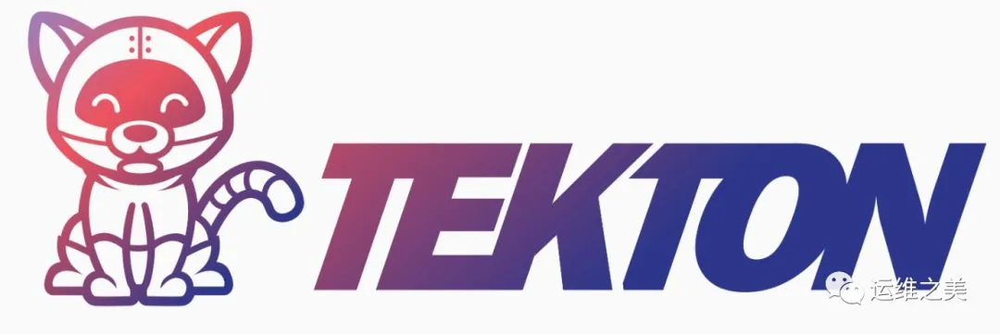
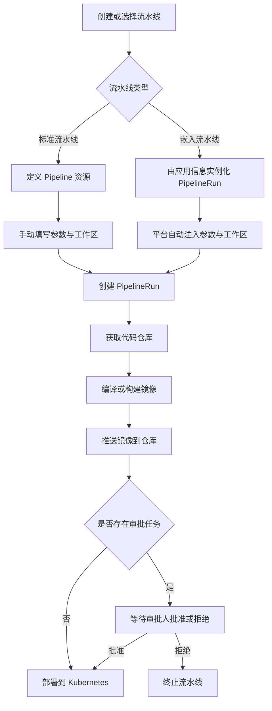
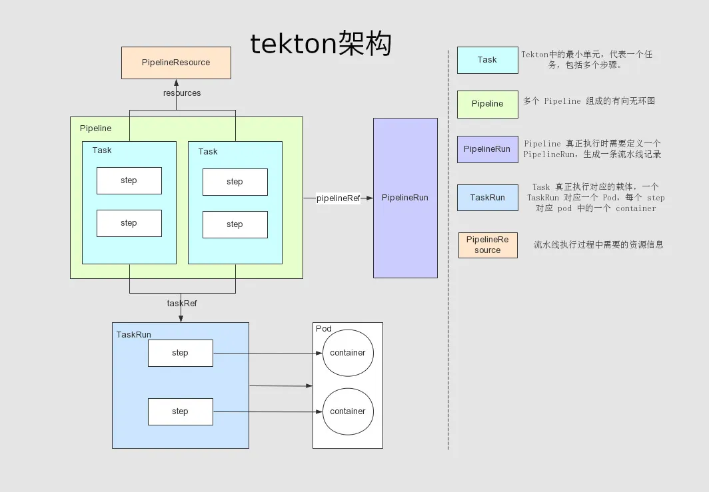

## 概述

:::note

KDO平台的流水线模块是基于[Tekton](https://tekton.dev/)实现的，Tekton 是一个强大、灵活的构建 `CI/CD` 流水线系统的开源框架，允许开发者构建、测试和发布应用。 
`Tekton` 是云原生的，通过定义CRD，让用户快速灵活定义流水线。

:::

## 流水线执行流程

## Tekton的优点

1. **可定制的：** Tekton实体是完全可定制的，从而具有高度的灵活性。平台工程师可以定义非常详细的构建基目录，以供开发人员在各种情况下使用
2. **可重复使用的：** Tekton实体是完全可移植的，因此一旦定义，组织内的任何人都可以使用给定的管道并重用其构造块。这使开发人员可以快速构建复杂的管道，而无需“重新发明轮子”。
3. **可扩展的：** Tekton Catalog是Tekton社区驱动的存储库。您可以使用Tekton目录中的预制组件快速创建新的并展开现有管道。 
4. **标准化：** Tekton在您的Kubernetes集群上作为扩展安装并运行，并使用完善的Kubernetes资源模型。 Tekton工作负载在Kubernetes容器中执行。 
5. **缩放性：** 为了增加工作负载容量，您可以简单地将节点添加到集群。 Tekton与您的集群进行缩放，无需重新定义您的资源分配或对管道的任何其他修改

## 和其他工具的对比

| 指标     | Tekton                                    | Jenkins X                                  | Argo CD                               |
|:-------|:------------------------------------------|--------------------------------------------|---------------------------------------|
| 安装与部署  | 提供Tekton Operator用于安装、移除、更新Tekton组件       | 提供一个方便使用的命令行工具 jx可用来安装Jenkins X            | 通过k8s yaml文件部署，并且提供多租户的部署模式           |
| 高可用    | 通过配置Deployment的多副本实现	                     | 通过配置Deployment的多副本实现	                      | 通过配置Deployment的多副本实现                  |
| 并发构建性能 | 依赖Kubernetes 的 Pod 调度能力，通过对集群节点扩容即可提升并发能力 | 依赖Kubernetes 的 Pod 调度能力，通过对集群节点扩容即可提升并发能力	 | 不提供CI能力依赖其他工具，CD性能取决于Git仓库和Kubernetes |
| 易用性    | kdo平台提供功能丰富的Web UI页面	                     | 提供功能丰富的Web UI页面	                           | 提供功能丰富的Web UI页面                       |
| 扩展性    | Tekton Hub提供100+插件。自研插件也比较简单，没有开发语言限制	    | 插件生态丰富	                                    | 不支持插件扩展                               |
| 成熟度    | CD基金会项目，开源社区活跃Github star数7.7k。           | CD基金会项目，开源社区活跃Github star数4.3k。	           | 开源社区活跃Github star数12.3k。              |
| 复杂度    | 非常轻量，易于维护	                                | 架构较为复杂，组件众多，需要一定的维护成本	                     | 架构比较简单，易于维护                           |
| 开发工具集成 | 支持	                                       | 不支持                                        | 不支持                                   |

## Tekton的资源对象

:::note

Tekton 资源对象是构成 Tekton Pipelines 的核心组件，它们定义了 CI/CD 流水线中的各种逻辑和行为。
通过这些资源对象，Tekton 提供了一个灵活且强大的框架，用于构建和管理持续集成和持续交付(CI/CD)流程。每个资源都有其独特的功能，并且可以根据需求组合起来创建复杂的工作流。

:::

### Task
**任务(Task)** 是执行具体工作单元的基本构建块。它定义了一组按顺序执行的步骤（Steps），每个步骤都是一个容器操作。可以接受参数 ([params](#params)) 和输出结果 (results)。支持声明工作区 ([workspaces](#workspaces)) 以便于数据共享。步骤之间可以互相传递数据。 

### ClusterTask
**集群任务(ClusterTask)** 与普通 Task 类似，但是 ClusterTask 是集群范围内的资源，可以在整个 Kubernetes 集群中使用。 ClusterTask 不局限于某个命名空间，适用于跨命名空间的任务定义。

### TaskRun
**任务运行(TaskRun)** 是对单个 Task 的一次具体执行实例化。 提供具体的参数值、工作区绑定等运行时信息给 Task。 记录执行的状态和结果。

### Pipeline
**流水线(Pipeline)** 定义了一个或多个 Task 的执行流程，以及这些任务之间的依赖关系。 Pipeline组织多个 Task 成为一个有序的工作流。 支持并行执行任务。 可以定义参数来动态配置 Pipeline 行为。 

### PipelineRun
**流水线运行(PipelineRun)** 是对 Pipeline 的一次具体执行实例化。 PipelineRun实例化并触发 Pipeline 中定义的所有 Task。 可以提供参数、工作区和其他运行时配置。

### Condition 
**条件(Conditions)** 允许在 Tekton Pipelines 中基于某些检查的结果来决定是否继续执行流水线。 它可用于实现更复杂的业务逻辑控制。Conditions支持自定义条件逻辑。

### Resource 
**资源(Resource)** 在早期版本来表示输入和输出的数据源，但在较新的版本中已经被弃用，转而推荐使用 Workspaces 和 Params 来处理数据。

### Trigger
**触发器(Triggers)** 允许你设置规则，当满足特定事件时自动启动 PipelineRuns 或 TaskRuns。 Triggers包括 EventListener 和 TriggerTemplate 等子组件。
它支持 Git 提交、PR 创建等多种触发方式。

### Params
**参数(Params)** 允许你向Pipelines、Tasks 和 PipelineRuns 传递配置信息，使得这些资源可以更加灵活和动态地执行。参数可以用于定义诸如版本号、构建选项、环境变量等可以在运行时改变的值。

### Workspaces
**工作区(Workspace)** 允许你为 PipelineRuns 和 TaskRuns 指定持久卷或其他存储资源。工作区提供了一种机制，使得 Tasks 可以访问共享的数据或代码库，并且可以在多个步骤之间保持数据的一致性和可用性。

## kdo流水线

KDO 平台使用流水线主要有两种方式：**标准流水线**和**嵌入流水线**。

### 标准流水线

标准流水线就是一个 Kubernetes `Pipeline` 对象，适合直接在流水线页面维护 Task 与运行参数。

- [标准流水线配置与示例](/docs/developer/delivery/pipelines/standard-pipeline/)

### 嵌入流水线

嵌入流水线是一个 `PipelineRun` 资源对象，通过模板实例化运行；创建 Git 应用时会自动生成，适合按应用维护构建与部署流程。

- [嵌入流水线配置与示例](/docs/developer/delivery/pipelines/embedded-pipeline/)

#### 编辑嵌入流水线

在应用详情中打开流水线，使用图形化组件或 YAML 编辑嵌入流水线。

- [编辑嵌入流水线与组件说明](/docs/developer/delivery/pipelines/embedded-pipeline/#编辑嵌入流水线)

## 审批任务 (ApprovalTask)

ApprovalTask 在 PipelineRun 的 DAG 中插入人工审批节点，执行到该节点会阻塞，等待批准、拒绝或超时。

- [审批任务工作原理、CRD 与控制台操作](/docs/developer/delivery/pipelines/approval-task/)

## 管理员视角

管理员负责 Tekton 基础设施、平台 Task、ServiceAccount、镜像密钥、权限和容量，并处理 Running、未触发等运行问题。

- [流水线管理员职责、典型场景与排障](/docs/developer/delivery/pipelines/admin/)

## 相关链接

- [Tekton Pipelines 官方文档](https://tekton.dev/docs/pipelines/)
- [Pipelines-as-Code 交付流程](/docs/developer/delivery/pac/)
- [源码持续交付与自动部署](/docs/developer/best-practices/continuous-delivery/source-code/#构建写回与自动部署)
- [权限管理](/docs/admin/access-control/rbac/)
- [可观测性](/docs/observability/)
