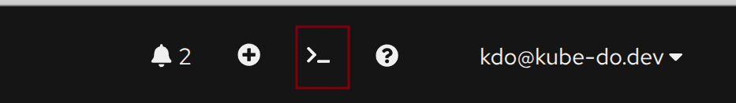
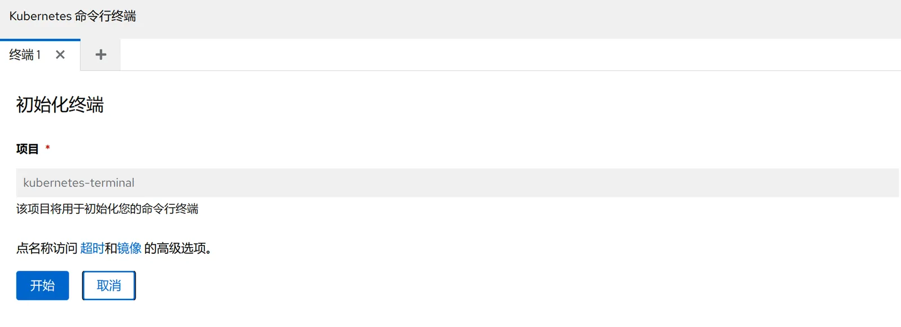
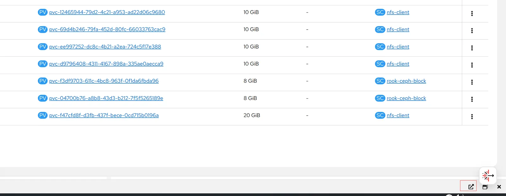
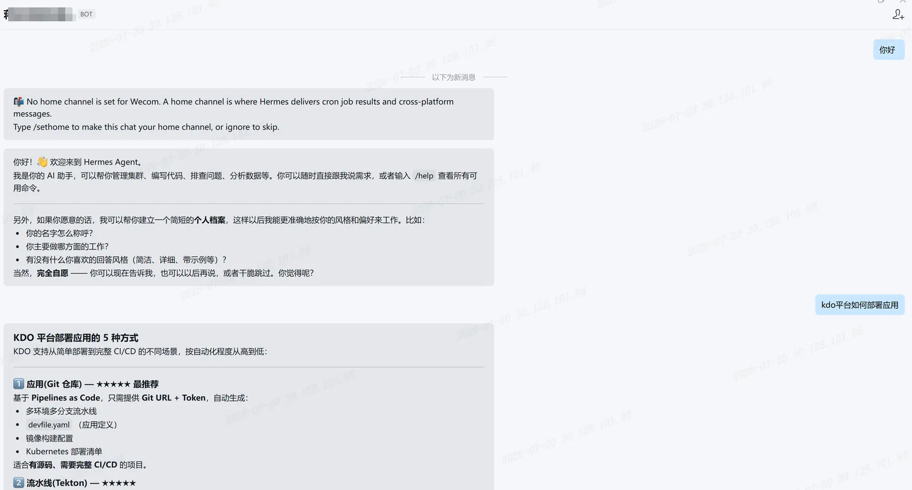

上级：[命令行模式](/docs/developer/dev-environments/terminal/)

CloudShell 主要面向对 Kubernetes 有深入了解的开发者和运维人员，它通过命令行提供了高效的问题处理能力。
用户不仅能够快速解决日常问题，还可以通过定制化脚本实现批量操作，从而大幅提升工作效率，让复杂任务变得简单而高效。
<video class="doc-video" controls muted loop autoplay playsinline preload="metadata" poster="/media/docs/developer/dev-environments/terminal/img/cloudshell-operation-poster.webp" aria-label="cloudshell-operation.gif"><source src="/media/docs/developer/dev-environments/terminal/img/cloudshell-operation.mp4" type="video/mp4" /></video>
## CloudShell命令行界面优势
KDO CloudShell 是一种基于云的命令行界面（CLI），KDO CloudShell可以为用户提供一系列优势，主要包括：
1. **无需安装和配置：** 用户不需要在本地计算机上安装Kubernetes CLI工具(`kubectl、oc、helm、istioctl、tkn`等)或其他依赖项。这节省了设置环境的时间，特别是在需要快速访问集群进行管理和故障排查时。
2. **随时随地访问：** 只要有浏览器和互联网连接，就可以从任何地方访问您的Kubernetes集群。这对于远程工作或处理紧急问题非常有用。
3. **安全性高：** 由于 `CloudShell` 是直接与您的KDO账户集成的，因此它继承了KDO平台安全措施。这意味着您不需要担心密钥管理或SSH访问的问题。
4. **即时性：** 由于它是基于云的，所以能够立即反映最新的状态和更新，确保您总是使用最新版本的工具和访问最新的集群数据。
5. **内置认证：** 自动与您的KDO账户进行身份验证，省去了手动配置kubectl以连接到不同集群的麻烦。
6. **便捷的多集群管理：** 对于管理多个Kubernetes集群的用户来说，`CloudShell` 提供了一种简单的方法来切换不同的上下文，而无需重新配置本地环境。
总的来说，KDO CloudShell 为开发者和运维人员提供了便捷、高效且安全的方式来管理和操作Kubernetes集群，尤其适合那些希望减少本地环境配置复杂性的用户

## 访问CloudShell命令行界面
KDO CloudShell 集成在KDO的管理控制台中，点击KDO页面右上角的这个图标就可以访问

如果是集群管理员，默认会创建`kubernetes-terminal`这个命名空间，其他用户可以选择对应[项目的命名空间](/docs/developer/projects/)



## 使用AI-Agent
CloudShell集成了[Hermes Agent](https://github.com/NousResearch/hermes-agent),实现通过各种通讯软件(比如:微信、企业微信、QQ、钉钉)来管理KDO平台，包括应用和流水线，排查问题，监控告警这些。

## 打开CloudShell
首先通过新tab的方式打开CloudShell，主要terminal内容比较多，建议使用`F11浏览器全屏模式`，便于访问。


## 文件上传与下载

:::note

CloudShell（包括独立终端页面 `/terminal` 和页面底部弹出的 Cloud Shell 抽屉）支持在终端中**上传、下载文件**，复用容器组的文件传输能力：

:::

- 终端工具栏右侧提供 **上传**、**下载** 按钮，可与多标签终端在同一行使用。
- **上传**：把本地文件上传到当前终端的工作目录。
- **下载**：把终端中的文件下载到本地（例如日志、生成的配置等）。
- 文件传输会跟随**当前选中的集群**，在多集群环境下自动切换到对应集群执行。

## 配置大模型

:::note

**注意:** AI Agent需要提前获取对应大模型的api key，比如：deepseek、阿里云这些，这些大模型会按量收费。

:::

<video class="doc-video" controls muted loop autoplay playsinline preload="metadata" poster="/media/docs/developer/dev-environments/terminal/img/hermas-setup-1-poster.webp"><source src="/media/docs/developer/dev-environments/terminal/img/hermas-setup-1.mp4" type="video/mp4" /></video>

## 配置消息通道

:::note

**注意:** Hermes在配置有些消息通道(比如企业微信)时不会自动重启gateway组件，一般建议手动运行一下 `hermes gateway restart`。

:::

<video class="doc-video" controls muted loop autoplay playsinline preload="metadata" poster="/media/docs/developer/dev-environments/terminal/img/hermas-setup-2-poster.webp"><source src="/media/docs/developer/dev-environments/terminal/img/hermas-setup-2.mp4" type="video/mp4" /></video>

### 验证Agent
现在我们可以打开消息通道(比如企业微信)和Agent进行沟通了。


### 注意事项

:::note

1. agent的权限和用户在KDO 平台的权限一致，比如普通用户只有对应项目的权限，没有集群相关权限，所以不用担心安全风险。
2. 访问KDO 平台的权限有时效性，如果发现无法访问 KDO，需要用户重新登录一下 KDO 平台，重新访问一下CloudShell。

:::

## 预装工具

:::note

CloudShell 预装了常用的 Kubernetes 和云原生工具，开箱即用，无需额外安装。

:::

| 工具 | 说明 | 常用命令示例 |
|------|------|-------------|
| **kubectl** | Kubernetes 命令行工具 | `kubectl get pods`、`kubectl apply -f` |
| **oc** | Kubernetes CLI（含登录功能） | `oc login`、`oc get pods` |
| **helm** | Kubernetes 包管理器 | `helm install`、`helm list` |
| **tkn** | Tekton Pipeline CLI | `tkn pipeline list` |
| **istioctl** | Istio 服务网格管理 | `istioctl analyze` |
| **jq** | JSON 处理工具 | `kubectl get pods -o json \| jq` |
| **yq** | YAML 处理工具 | `yq eval` |
| **curl** | HTTP 请求工具 | `curl https://api.example.com` |
| **git** | 版本控制工具 | `git clone`、`git status` |

:::info

CloudShell 中的工具版本会随平台更新而自动升级，始终使用最新版本。如需查看当前工具版本，可在终端中执行 `kubectl version` 或 `helm version` 等命令。

:::

## 资源限制

:::warning

CloudShell 运行在 Kubernetes Pod 中，受到资源配额限制。请合理使用，避免因资源耗尽导致终端无响应。

:::

| 资源 | 默认配额 | 说明 |
|------|---------|------|
| **CPU** | 1 核 | 单个终端会话的 CPU 限制 |
| **内存** | 1 Gi | 单个终端会话的内存限制 |
| **临时存储** | 1 Gi | `/tmp` 等临时目录的存储空间 |
| **持久化存储** | 5 Gi | `/home/user` 目录的持久化存储空间 |

## 网络访问

CloudShell 的网络访问能力取决于其运行的命名空间和网络策略配置：

| 访问目标 | 默认支持 | 说明 |
|---------|---------|------|
| **集群内服务** | 是 | 可直接通过 Service 名称访问集群内部服务 |
| **集群内 Pod** | 是 | 可通过 kubectl exec 进入 Pod 调试 |
| **外部网络** | 视配置 | 需要配置出口网络策略或代理 |
| **Kubernetes API** | 是 | 自动连接到当前集群的 API Server |

## 自定义环境

:::note

CloudShell 支持自定义 Shell 环境，常用的配置可以持久化到 `/home/user` 目录。

:::

### 设置别名

将常用命令的别名添加到 `/home/user/.bashrc` 文件中：

```bash
# 编辑持久化 bashrc
vi /home/user/.bashrc

# 添加常用别名
alias gp='kubectl get pods'
alias gs='kubectl get svc'
alias gd='kubectl get deployment'
alias kl='kubectl logs -f'
alias ocg='oc get pods'
```

使配置生效：

```bash
source /home/user/.bashrc
```

### 持久化环境变量

将自定义环境变量写入 `/home/user/.bash_profile`：

```bash
# 编辑持久化 bash_profile
vi /home/user/.bash_profile

# 添加环境变量
export EDITOR=vim
export KUBE_EDITOR=vim
```

## 关闭终端会话

1. 直接关闭浏览器标签页或点击终端区域的关闭按钮
2. 终端会话将自动停止，`/home/user` 目录中的数据会保留
3. 下次打开 CloudShell 时，将创建新的终端会话

:::note

- 关闭终端不会影响正在运行的 Kubernetes 资源
- 如果在终端中运行了后台进程（如 `nohup`），关闭终端后进程可能会终止
- 需要长期运行的命令建议使用 [Jobs](/docs/developer/workloads/jobs/) 或 [CronJobs](/docs/developer/workloads/cronjobs/)

:::
