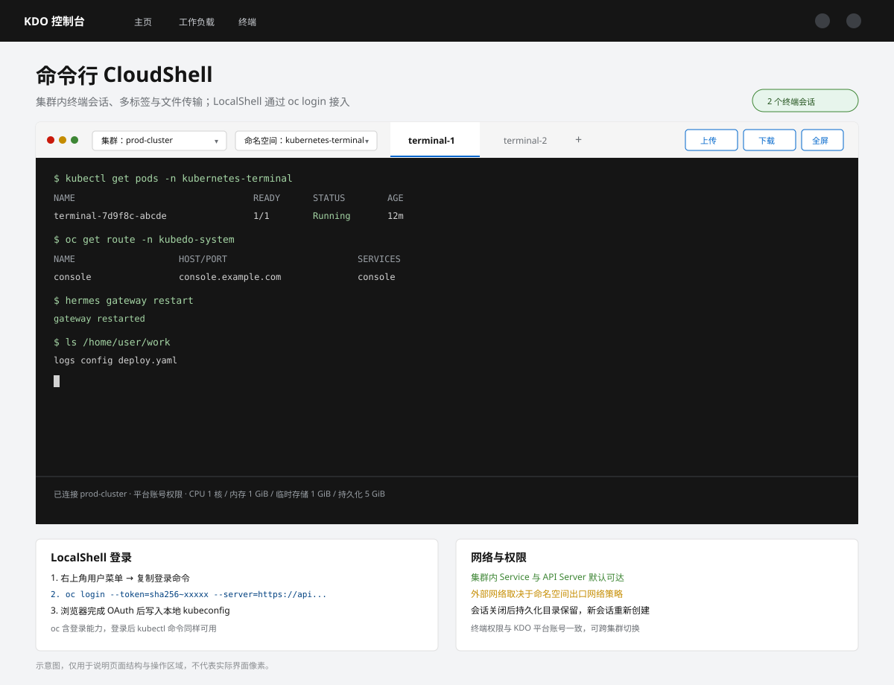
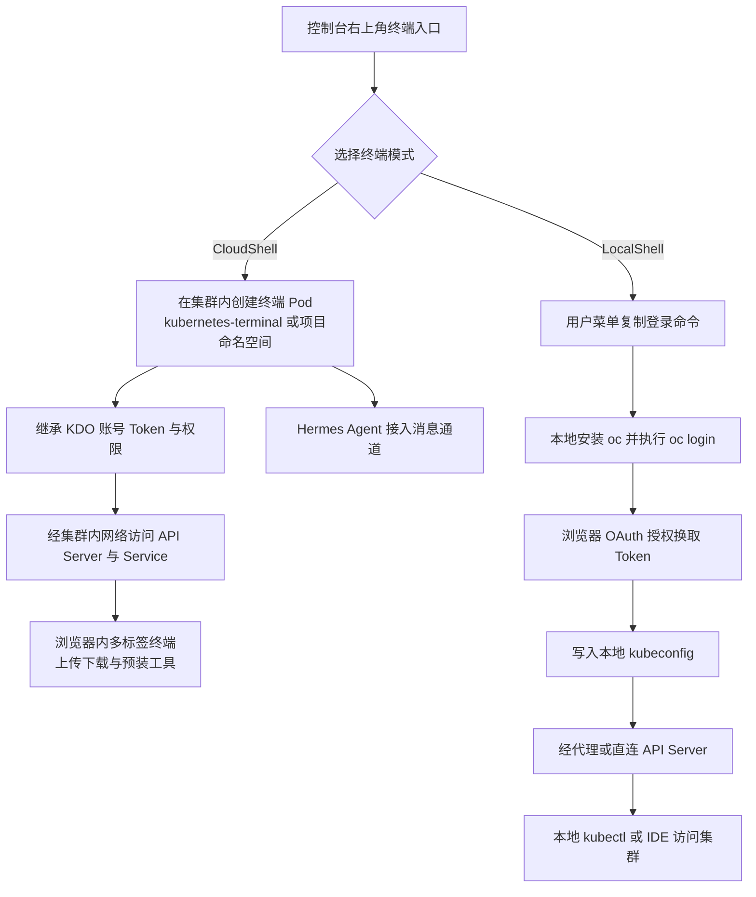

:::note

与其他容器云平台相比，KDO平台在命令行功能上表现出色，提供了强大的支持。
它不仅兼容 `CloudShell`，还支持 `LocalShell`，为运维人员和开发人员带来了极大的便利和高效的操作体验。
无论是云端还是本地环境，KDO平台都能满足多样化的需求，显著提升工作效率。

:::

*图：CloudShell 的集群与命名空间选择、多标签、上传下载按钮及 LocalShell 登录入口。*

## 两种终端的工作流程

两种模式的分界线在鉴权与网络位置：CloudShell 的终端 Pod 运行在集群内，直接继承平台账号权限并从集群内部访问 API Server；LocalShell 把登录凭据落到本地 kubeconfig，请求从开发者机器经代理或直连到达集群。

## 两种模式怎么选

| 维度 | CloudShell | LocalShell |
|---|---|---|
| 运行位置 | 集群内终端 Pod | 本地终端 |
| 是否需要安装工具 | 不需要，预装 kubectl、oc、helm、tkn 等 | 需要本地安装 `oc` |
| 鉴权方式 | 继承 KDO 账号 Token | 浏览器 OAuth 后写入本地 kubeconfig |
| 适用场景 | 快速排障、集群内网络访问、临时操作 | 本地 IDE、长期运维、多集群管理 |
| 文件传输 | 浏览器上传/下载 | 使用本地文件系统 |

## CloudShell模式

CloudShell 在集群内创建终端 Pod，直接继承平台账号权限，适合快速排障和临时操作。

- [进入 CloudShell 并了解预装工具、AI Agent、文件上传下载](/docs/developer/dev-environments/terminal/cloudshell/)

## LocalShell模式

LocalShell 把登录凭据落到本地 kubeconfig，适合本地 IDE、多集群管理和长期运维。

- [配置 LocalShell、下载 kubeconfig、设置代理与 IDE 集成](/docs/developer/dev-environments/terminal/localshell/)

## 常用操作示例

资源查看、资源管理、调试排查和 Helm 操作的常用命令已整理到 LocalShell 页面。

- [查看常用操作示例](/docs/developer/dev-environments/terminal/localshell/#常用操作示例)

## FAQ / 故障排查

- [CloudShell 常见问题](/docs/developer/dev-environments/terminal/cloudshell/)
- [LocalShell 与网络常见问题](/docs/developer/dev-environments/terminal/localshell/#faq)
