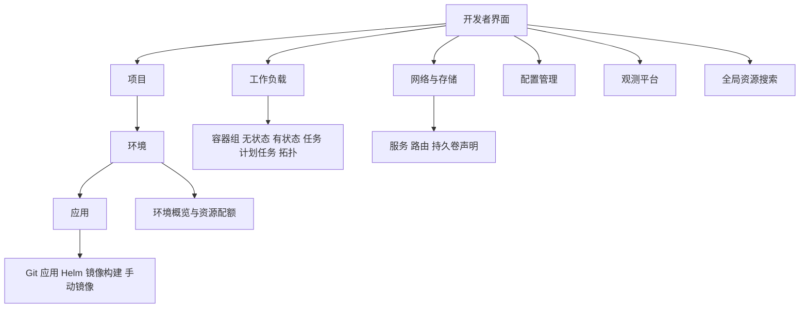
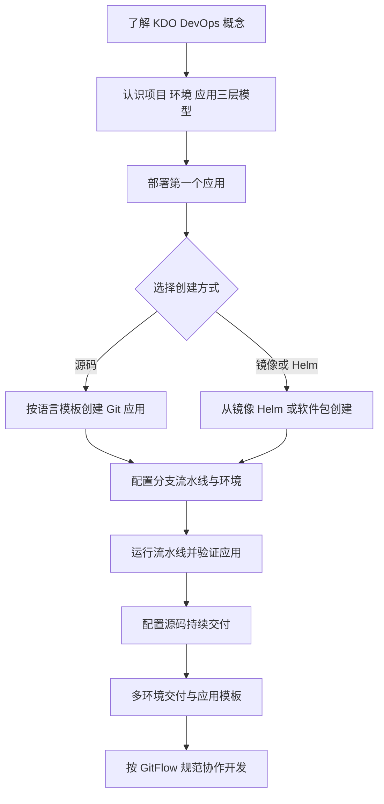

## 开发者界面
开发者界面专注于优化应用的研发流程，使得开发者无需深入了解容器和Kubernetes的底层原理即可高效工作。
主要面向开发者和测试人员，开发者界面采用了`项目`、`环境`、`应用`三层模型，简化了复杂的应用管理任务：

1. **项目：** 代表一组相关的应用程序和服务，通常对应一个业务线或大型功能模块。[更多信息](/docs/developer/projects/)
2. **环境：** 定义了运行应用的不同场景，如开发、测试或生产环境，确保代码可以在不同的阶段无缝迁移。[更多信息](/docs/developer/projects/)
3. **应用：** 具体的应用程序单元，包含部署所需的全部信息和资源。[更多信息](/docs/developer/applications/git/)

这种结构不仅促进了团队间的协作，还通过清晰的层次划分提高了管理效率，使得开发者可以更加专注于创新和代码质量，而无需担心底层架构的复杂性。

## 三层模型与功能入口

<video class="doc-video" controls muted loop autoplay playsinline preload="metadata" poster="/media/docs/developer/imgs/dev-start-poster.webp" aria-label="开发者界面"><source src="/media/docs/developer/imgs/dev-start.mp4" type="video/mp4" /></video>

## 能力地图与学习路径

建议按以下顺序阅读：

1. **概念与模型**：[KDO DevOps 介绍](/docs/developer/overview/devops/)
2. **创建应用**：[应用管理](/docs/developer/applications/)
3. **流水线与交付**：[持续交付](/docs/developer/best-practices/continuous-delivery/)
4. **项目与环境**：[项目管理](/docs/developer/projects/)
5. **分支协作**：[GitFlow](/docs/developer/best-practices/gitflow/)

日常开发通常从 **创建 Git 应用** 开始：选择代码仓库和语言模板，KDO 会生成构建与部署所需文件，并在代码推送后自动触发流水线。

## 常用入口

- [创建 Git 应用](/docs/developer/applications/git/)
- [应用管理](/docs/developer/applications/)
- [工作负载](/docs/developer/workloads/)
- [工作负载操作](/docs/developer/workload-operations/)
- [配置管理](/docs/developer/configuration/)
- [网络与存储](/docs/developer/network-storage/)
- [终端与开发环境](/docs/developer/dev-environments/terminal/)
- [AI 助手](/docs/developer/ai-assistant/)
