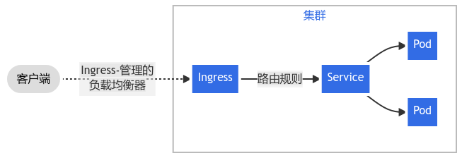
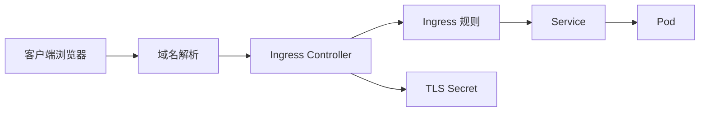
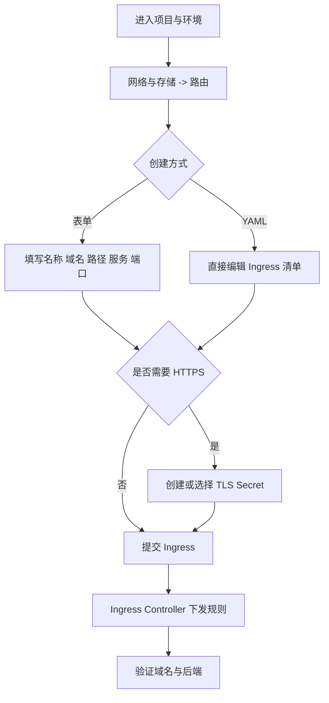
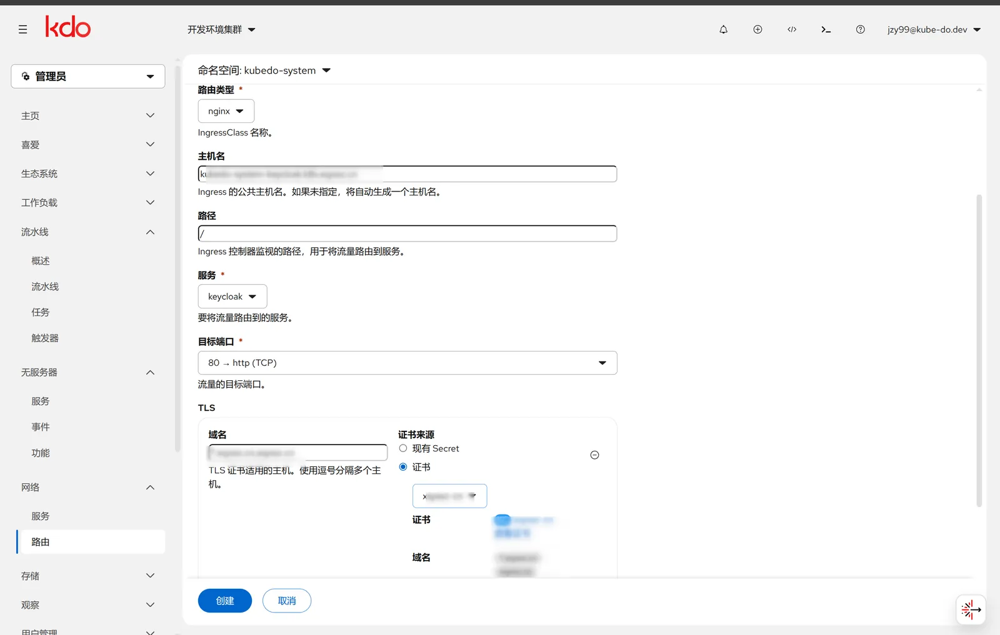
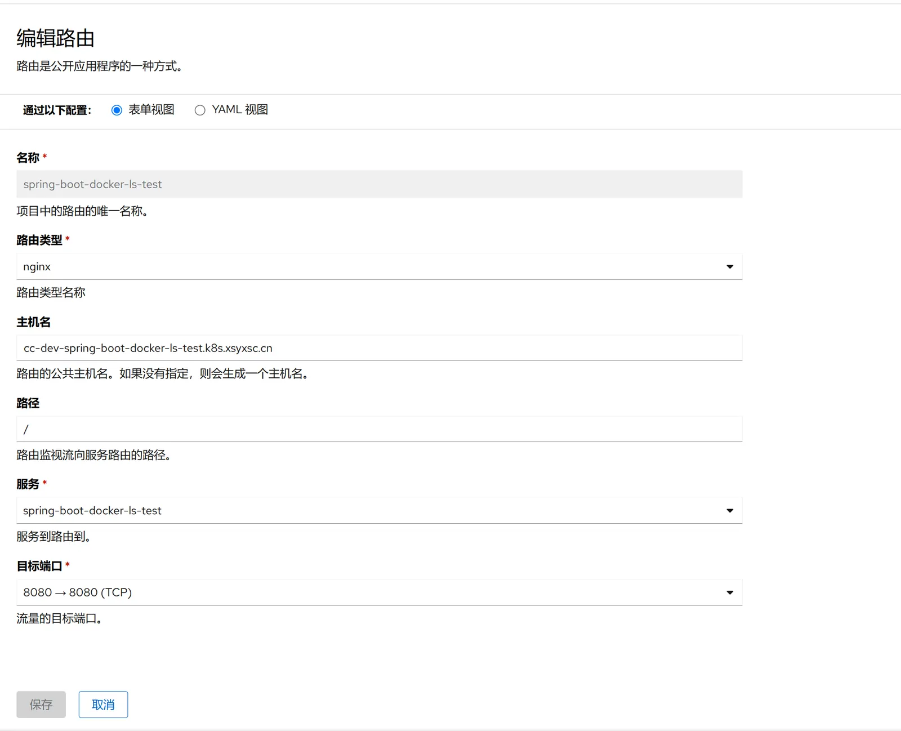

## 介绍

Kubernetes 的 Ingress 负责把集群外的 HTTP/HTTPS 请求转发到集群内的 Service。KDO 在 Ingress 之上提供图形化表单，同时保留 YAML 视图，便于配置高级注解。

:::note

Ingress 只描述路由规则，真正承接流量的是 Ingress Controller。KDO 默认使用 `nginx-ingress`，创建路由前应确认目标集群已安装对应的 Ingress Controller。

:::



## 对象关系



一个 Ingress 可以配置多条规则，每条规则按主机名和路径匹配，再把请求转发到对应的 Service 端口。

<a id="新增路由"></a>

## 创建路由

### 创建流程



### 常用字段

| 字段 | 说明 | 示例 |
|---|---|---|
| 名称 | Ingress 资源名称，同一命名空间内唯一 | `web-ingress` |
| 路由类型 | IngressClass，决定由哪个控制器处理 | `nginx-ingress` |
| 主机名 | 对外访问域名，需能解析到入口地址 | `app.example.com` |
| 路径 | URL 路径，通常以 `/` 开头 | `/` |
| 服务 | 后端 Service 名称 | `web-service` |
| 目标端口 | Service 暴露的端口 | `80` |

填写完成后提交。KDO 会创建 Ingress 资源，Ingress Controller 随后把规则下发到入口网关。

<video class="doc-video" controls muted loop autoplay playsinline preload="metadata" poster="/media/docs/developer/network-storage/ingress/imgs/create-ingress-poster.webp" aria-label="创建路由"><source src="/media/docs/developer/network-storage/ingress/imgs/create-ingress.mp4" type="video/mp4" /></video>

## 配置 TLS

KDO 支持通过 `KdcCertificate` 自动申请和续期证书，并把证书写入指定的 Secret，供 Ingress 引用。



### 自动填充主机名

在表单中填写主机名后，证书域名会自动带入，避免证书域名与 Ingress 主机名不一致。

### 证书信息

| 字段 | 说明 |
|---|---|
| 证书域名 | 证书覆盖的域名，通常与 Ingress 主机名一致 |
| 到期时间 | 证书有效期，到期前由平台自动续期 |
| 来源 | 证书来源，可选择平台纳管的证书或已有 Secret |
| 集群 | 证书所在集群；多集群场景下从主集群读取来源 Secret |

### Secret 使用规则

- Ingress 通过 `tls.secretName` 引用 Secret，Secret 必须与 Ingress 在同一命名空间。
- 可以复用已有 TLS Secret，也可以让 `KdcCertificate` 新建 Secret。
- **先创建证书和 Secret，再创建或更新 Ingress**，避免 Ingress 引用不存在的 Secret。
- 在 YAML 视图中直接编辑 Ingress 时，不会自动生成证书；需要先单独创建 `KdcCertificate`。
- 多集群场景下，目标集群的 Secret 由平台从主集群的来源 Secret 同步，不要手工在各集群重复维护。

:::warning

证书域名必须与访问域名匹配。使用泛域名证书时，确认 `*.example.com` 能覆盖当前主机名，否则浏览器仍会提示证书不匹配。

:::

## 验证访问

1. 确认域名已解析到入口地址：

   ```bash
   nslookup app.example.com
   ```

   本地测试也可以把域名写入 `/etc/hosts`，指向 Ingress Controller 的入口 IP。

2. 查看 Ingress 状态和入口地址：

   ```bash
   kubectl get ingress -n <namespace>
   kubectl describe ingress <ingress-name> -n <namespace>
   ```

3. 检查后端 Service 和 Endpoints：

   ```bash
   kubectl get service <service-name> -n <namespace>
   kubectl get endpoints <service-name> -n <namespace>
   ```

   Endpoints 为空通常表示 Service 选择器没有匹配到 Pod，或 Pod 未就绪。

4. 发起请求：

   ```bash
   curl -I http://app.example.com/
   curl -I https://app.example.com/
   ```

5. HTTPS 场景检查证书链和域名：

   ```bash
   openssl s_client -connect app.example.com:443 -servername app.example.com
   ```

## 编辑路由与高级注解



图形界面适合修改主机名、路径、后端 Service 和端口等基础配置。超时、请求体大小、重写路径等高级能力需要切换到 YAML 视图，通过注解配置。

| 注解 | 作用 | 常见场景 |
|---|---|---|
| `nginx.ingress.kubernetes.io/rewrite-target` | 重写转发路径 | 后端服务不接收前缀路径 |
| `nginx.ingress.kubernetes.io/proxy-body-size` | 限制请求体大小 | 文件上传接口返回 413 |
| `nginx.ingress.kubernetes.io/proxy-read-timeout` | 后端读取超时 | 长连接、慢接口 |
| `nginx.ingress.kubernetes.io/ssl-redirect` | HTTP 强制跳转 HTTPS | 只允许 HTTPS 访问 |
| `nginx.ingress.kubernetes.io/whitelist-source-range` | 来源 IP 白名单 | 管理后台限制访问来源 |

注解由 Ingress Controller 解析，不同控制器支持的注解不同。修改前确认当前集群使用的是 `nginx-ingress`，并参考 [Nginx Ingress 注解文档](https://kubernetes.github.io/ingress-nginx/user-guide/nginx-configuration/annotations/)。

## 故障排查

### 访问返回 404

- 检查 Ingress 的主机名和路径是否与请求 URL 完全匹配。
- 确认请求命中的是预期的 Ingress，而不是默认后端。
- 使用 `kubectl describe ingress` 查看规则和后端 Service。

### 访问返回 502 或 503

- 检查 Service 的 Endpoints 是否为空。
- 确认 Pod 处于 Ready 状态，健康检查没有失败。
- 检查目标端口是否填写正确，Service 的 `targetPort` 是否与容器监听端口一致。
- 查看 Ingress Controller 和后端 Pod 日志。

### HTTPS 证书错误

- 确认 `tls.secretName` 指向的 Secret 存在，且包含 `tls.crt`、`tls.key`。
- 检查证书域名是否覆盖当前访问域名。
- 确认证书没有过期，`KdcCertificate` 状态正常。
- 使用 `openssl s_client` 检查实际返回的证书链。

### Ingress 没有入口地址

- 检查集群是否安装了 Ingress Controller。
- 查看 Ingress Controller 的 Service 是否分配了外部 IP 或 LoadBalancer 地址。
- 确认 IngressClass 名称与控制器一致。

## 最佳实践

- **一个域名一条主规则**：避免同一主机名下的路径规则互相覆盖。
- **优先使用 HTTPS**：为生产域名配置 TLS，并开启 HTTP 到 HTTPS 跳转。
- **后端先就绪**：先确认 Service 和 Pod 健康，再创建或修改 Ingress。
- **谨慎使用通配符**：泛域名和宽泛路径容易把流量转发到错误后端。
- **注解最小化**：只添加当前场景需要的注解，并在变更后验证。
- **保留回滚配置**：修改 YAML 前保存原清单，出现问题时可以快速恢复。

## 相关文档

- [Service](/docs/developer/network-storage/service/)
- [无状态应用（Deployment）](/docs/developer/workloads/deployments/)
- [证书管理](/docs/admin/maintenance/certificates/)
- [日志](/docs/observability/logging/)
- [LocalShell 与本地运维](/docs/developer/dev-environments/terminal/localshell/)
