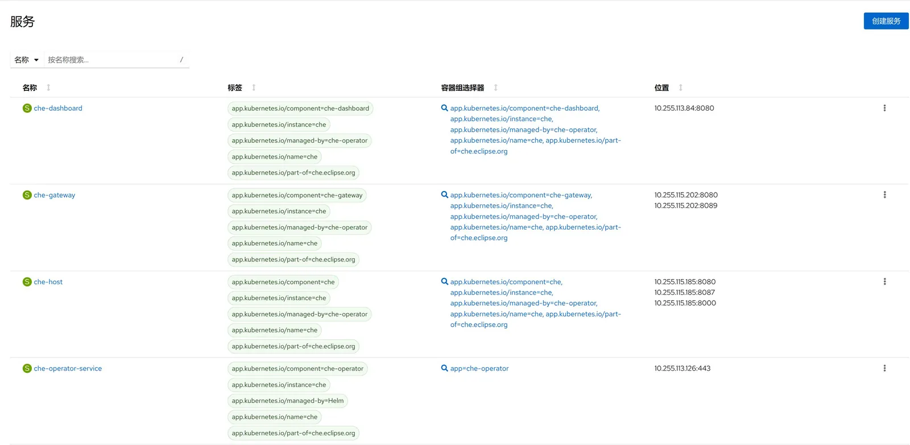
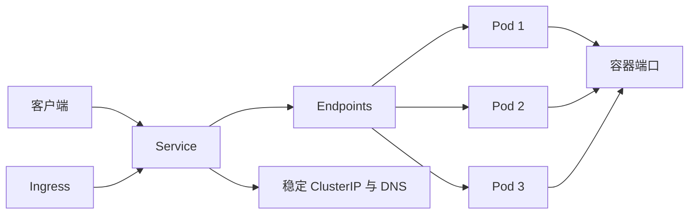
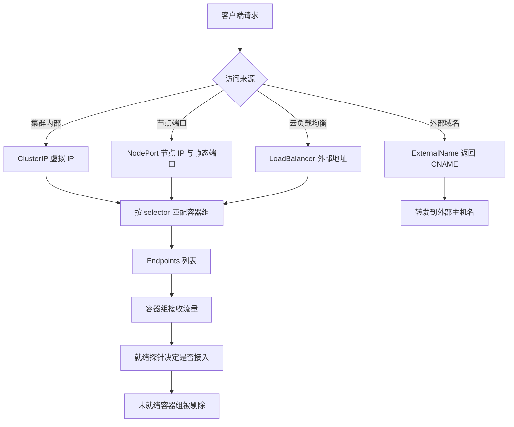
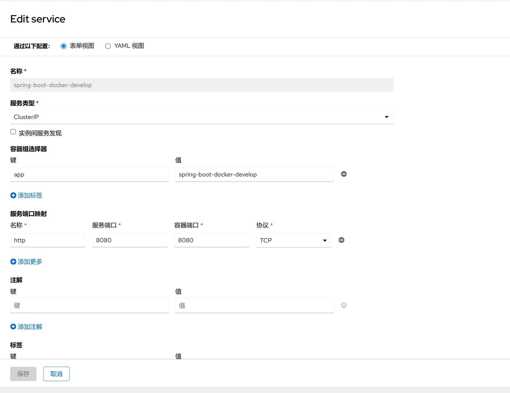

## 介绍

Kubernetes 中服务（Service）是将运行在一个或一组容器组上的网络应用公开为网络服务的方法。Service 为一组 Pod 提供稳定的虚拟 IP 和 DNS 名称，调用方不需要感知 Pod 的创建、删除或重新调度。

Service 通过 `selector` 选择 Pod，并把就绪的 Pod 放入 Endpoints。Pod 未就绪、标签不匹配或没有监听正确端口时，流量不会进入该 Pod。



## 对象关系



## 服务流量与类型



## 服务类型

1. **ClusterIP**：通过集群内部 IP 暴露 Service，只能在集群内访问，是默认类型。通常由 Ingress 或 Gateway API 对外暴露。
2. **NodePort**：在每个节点上开放一个静态端口，通过 `节点 IP:端口` 访问；同时会分配 ClusterIP。
3. **LoadBalancer**：使用云平台负载均衡器对外暴露；需要集群支持 LoadBalancer Controller。
4. **ExternalName**：把 Service 映射到外部主机名，通过 DNS CNAME 返回，不创建代理和 Endpoints。

KDO 控制台创建 Service 时通常使用 ClusterIP，再由[路由（Ingress）](/docs/developer/network-storage/ingress/)对外提供 HTTP/HTTPS 访问。

## 创建服务

在开发者界面进入目标项目和环境，打开 **网络与存储 → 服务**，点击 **创建服务**。需要填写：

| 字段 | 说明 |
| --- | --- |
| 名称 | Service 名称，集群内唯一 |
| 类型 | ClusterIP、NodePort、LoadBalancer 或 ExternalName |
| 选择器 | 匹配 Pod 的标签，必须与工作负载标签一致 |
| 端口 | Service 暴露的端口 |
| 目标端口 | 容器实际监听的端口，可以是端口号或端口名 |
| 协议 | TCP、UDP 或 SCTP，默认 TCP |

创建后可以在列表查看 ClusterIP、端口、类型和创建时间。

## 访问服务

集群内访问使用 DNS：

```text
<service>.<namespace>.svc.cluster.local:<port>
```

同命名空间内可以只写 `<service>:<port>`。跨命名空间必须使用完整域名。

验证：

```bash
kubectl get service <service> -n <namespace>
kubectl get endpointslice -n <namespace> -l kubernetes.io/service-name=<service>
kubectl run curl --rm -it --image=curlimages/curl -- \
  curl -sv http://<service>.<namespace>.svc.cluster.local:<port>
```

`EndpointSlice` 为空通常表示 selector 不匹配或 Pod 未就绪。

## 编辑服务



图形界面可以修改端口、选择器和类型等基础字段；高级能力（会话保持、外部流量策略、健康检查、注解）需要切换 YAML 视图。

## 常见问题

### 访问返回 503

- `EndpointSlice` 是否为空。
- Pod 是否 Ready，readinessProbe 是否通过。
- Service 的 `selector` 是否与 Pod 标签一致。
- `targetPort` 是否与容器实际监听端口一致。

### 访问返回 404

Service 已经转发到 Pod，但应用没有匹配的路径或路由规则。检查应用路由和 Ingress 的 path。

### 集群内可以访问，Ingress 不可以

检查 Ingress 的 `service.name`、`service.port`、Ingress Controller 状态和 NetworkPolicy。

### 修改端口后不生效

确认修改的是 `targetPort` 而不是只改 Service `port`；检查应用是否真的监听新端口，并重启或滚动更新工作负载。

### NodePort 无法访问

检查节点防火墙、安全组和 `externalTrafficPolicy`；云环境还需要确认负载均衡器或安全组放行。

## 最佳实践

- 使用命名端口（如 `http`）而不是硬编码端口号，便于模板复用。
- 为 Pod 配置 readinessProbe，避免流量进入未就绪实例。
- 不要用 `latest` 镜像和可变标签做 selector，标签要保持稳定。
- 生产环境优先使用 Ingress/LoadBalancer，不直接暴露大量 NodePort。
- 为关键服务配置 PodDisruptionBudget 和多个副本。
- 使用 NetworkPolicy 限制跨命名空间访问。

## 相关文档

- [路由（Ingress）](/docs/developer/network-storage/ingress/)
- [容器组（Pod）](/docs/developer/workloads/pods/)
- [无状态应用（Deployment）](/docs/developer/workloads/deployments/)
- [网络策略](/docs/admin/networking/network-policies/)
- [排障索引](/docs/reference/troubleshooting/)
