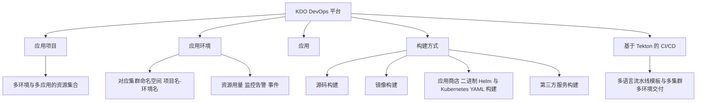
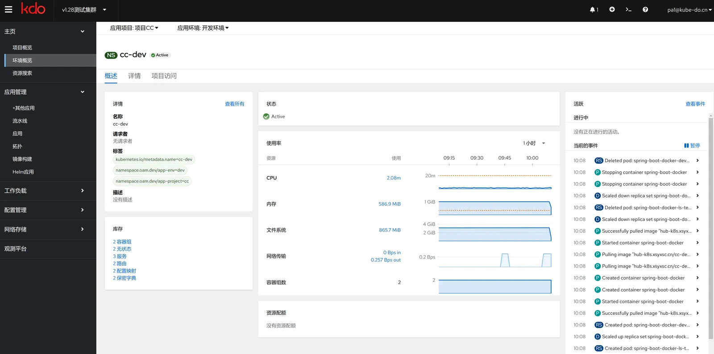
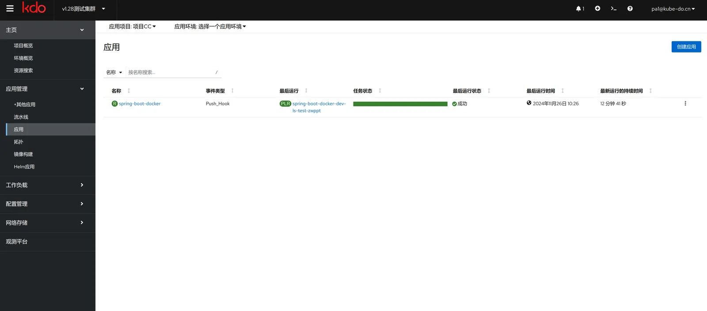

## kdo DevOps 指南概述

DevOps 是文化理念、技术实践和工具的组合，可促进技术运维和软件开发团队之间的集成、协作、沟通和自动化，从而提高软件交付的质量和速度。

### 功能

kdo DevOps 提供了以下功能：

- 源码构建，从源码开始构建应用
- 镜像构建，从镜像开始构建应用
- 应用商店构建，从应用商店中安装应用
- 二进制构建，从二进制文件开始构建应用
- Kubernetes YAML 构建，从 Kubernetes YAML 开始构建应用
- Helm 构建，从 Helm Chart 开始构建应用
- 第三方服务构建，对接平台外的第三方服务。

### kdo CI/CD

kdo CI/CD 是基于 [Tekton](https://tekton.dev/docs/) 的 CI/CD 工具，它可以帮助用户快速的从源码构建应用，同时支持多种语言和框架。无需编写复杂的 Pipeline，只需要简单的配置即可。

## 能力地图

平台以应用项目、应用环境、应用三层模型组织资源，向下对接多集群与命名空间，向上提供构建、部署与持续交付能力。

## kdo DevOps介绍

**KDO DevOps** 是一个支持多租户、多集群、多环境的 DevOps 平台，用户无需了解复杂的基础设施即可操作和维护应用。运维人员作为平台管理员，负责平台本身的运行。

KDO DevOps 使用应用项目、应用环境、应用三层模型。

### 应用项目

应用项目是应用系统的集合，包含多个环境和多个应用，通常对应一个业务线或产品。

### 应用环境

应用环境对应 Kubernetes 命名空间，命名规则为 `项目名-环境名`。例如项目名为 `abc`、环境名为 `dev`，对应命名空间为 `abc-dev`。

应用环境包含当前环境的资源使用情况、监控告警和事件（Event）。

### 应用

应用是部署和运行的最小单元，包含镜像、工作负载、服务、路由和配置等资源。

## 构建方式

| 构建方式 | 适用场景 |
|----------|----------|
| 源码构建 | Java、Go、Node.js、Python、.NET 等语言项目 |
| 镜像构建 | 已有镜像，直接部署 |
| 应用商店 | 安装平台预置应用 |
| 二进制构建 | 上传可执行文件或压缩包 |
| Kubernetes YAML | 已有 YAML 清单 |
| Helm | 使用 Helm Chart 部署 |
| 第三方服务 | 接入集群外的遗留服务 |

## 推荐阅读路径

1. 了解三层模型和构建方式：本页
2. 创建第一个应用：[创建 Git 应用](/docs/developer/applications/git/)
3. 选择语言模板：[语言与构建模板](/docs/developer/applications/languages/)
4. 配置流水线：[流水线](/docs/developer/delivery/pipelines/)
5. 配置多环境交付：[持续交付](/docs/developer/best-practices/continuous-delivery/)
6. 规范分支协作：[Git 分支策略](/docs/developer/best-practices/gitflow/)

## 相关文档

- [开发者概览](/docs/developer/overview/)
- [应用管理](/docs/developer/applications/)
- [项目与环境](/docs/developer/projects/)
- [工作负载](/docs/developer/workloads/)
- [Pipelines as Code](/docs/developer/delivery/pac/)
