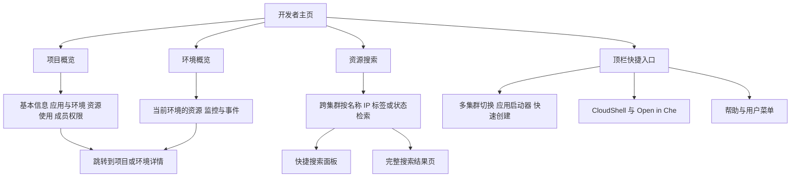

## 页面导航

## 项目概览

:::note

在**项目概览**页面，可以对当前项目有个整体认识，包括基本信息、应用与环境、资源使用、监控信息、成员权限、事件与通知等，并支持跨集群查看。[更多信息，访问项目管理](/docs/developer/projects/)

:::

## 环境概览

:::note

在**环境概览**页面，可以对当前项目的当前环境有个整体认识，包括基本信息、资源使用、监控信息、[事件](/docs/observability/events)等，点击对应链接可以直接访问对应的资源。

:::

<video class="doc-video" controls muted loop autoplay playsinline preload="metadata" aria-label="环境概览" poster="/media/docs/developer/overview/imgs/env-poster.webp"><source src="/media/docs/developer/overview/imgs/env.mp4" type="video/mp4" /></video>

## 资源搜索

:::note

控制台提供**多集群全局资源搜索**：点击顶栏搜索框或按 `Ctrl/Cmd + K`，可以按资源的`名字`、`IP 地址/CIDR`、`命名空间`、`标签`、`应用`或`状态`跨集群搜索容器组、服务、工作负载、路由、节点、命名空间等资源，支持模糊匹配与负向条件。按 `Enter` 打开结果，或点击 **View all results** 进入完整结果页。

:::

:::warning

由于KDO平台是基于[Kubernetes RBAC的权限模型](/docs/admin/access-control/rbac/)，有些资源虽然可以搜索到，但是却没有权限可以访问，不用担心有安全问题。

:::

[全局资源搜索详细说明](/docs/developer/overview/global-search/)

<video class="doc-video" controls muted loop autoplay playsinline preload="metadata" aria-label="全局资源搜索" poster="/media/docs/developer/overview/imgs/search-poster.webp"><source src="/media/docs/developer/overview/imgs/search.mp4" type="video/mp4" /></video>

## 顶栏快捷入口

:::note

控制台右上角工具栏提供了常用的全局快捷入口：

:::

| 入口 | 说明 |
|------|------|
| 全局搜索 | 跨集群搜索资源，支持 `Ctrl/Cmd + K` |
| 多集群切换 | 在多集群环境下切换当前操作的集群，切换后保持当前页面 |
| 应用启动器 | 打开已配置的外部应用/链接 |
| 快速创建 | 快速创建常用资源 |
| 访问云开发环境 (Open in Che) | 已配置 Eclipse Che 时显示，点击可在 Che 中打开云开发环境 |
| CloudShell | 打开云端命令行终端，[更多信息](/docs/developer/dev-environments/terminal/) |
| 帮助菜单 | 文档、关于、反馈等 |
| 用户菜单 | 通知设置、复制登录命令、下载 kubeconfig、退出登录等 |
