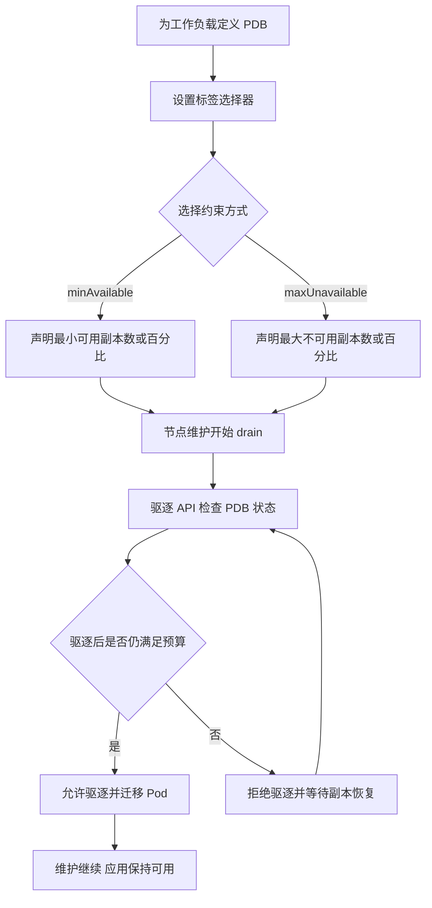
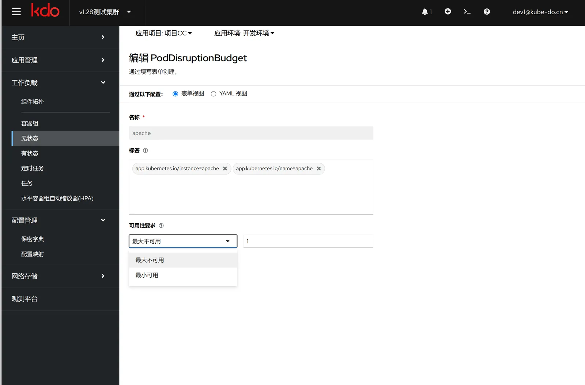

## 介绍

:::note

Kubernetes 的 PodDisruptionBudget (PDB) 是一种资源对象，它允许用户定义应用程序可以容忍的中断程度。
通过设置 PDB，你可以确保在计划内维护（例如节点升级、自动缩放等）期间，关键应用始终有一定数量的 Pod 在运行，从而避免服务不可用的情况

:::


## 工作流程



## 使用场景
1. **高可用性应用:** 对于需要保证一定水平的服务可用性的应用，比如数据库集群、API 服务器等，可以利用 PDB 来防止由于计划内的操作而导致的服务中断。
2. **批处理作业:** 对于那些即使部分失败也可以接受的任务，可以设置较低的 minAvailable 或较高的 maxUnavailable，以便更灵活地响应集群变化。
3. **节点维护:** 当执行节点级别的维护任务时，如更新操作系统或 Kubernetes 版本，PDB 可以帮助确保只有在安全的情况下才会迁移 Pod。


:::warning

PDB 仅适用于自愿中断（voluntary disruptions），如节点排空（drain）。对于非自愿中断（involuntary disruptions），如硬件故障或节点宕机，PDB 不起作用。
如果你的应用没有合适的标签选择器，那么 PDB 将不会生效。
PDB 应该根据实际业务需求和系统架构合理设计，以平衡可靠性和灵活性。

:::


## 配置方式
PDB 可以通过以下两种方式之一来定义：
1. **minAvailable(最小可用):** 指定最小可用 Pod 数量或百分比。
2. **maxUnavailable(最大不可用):** 指定最大不可用 Pod 数量或百分比。



## 配置示例

### 使用 minAvailable

```yaml
apiVersion: policy/v1
kind: PodDisruptionBudget
metadata:
  name: web-pdb
spec:
  minAvailable: 2
  selector:
    matchLabels:
      app: web
```

`minAvailable` 表示排空期间至少要保留的 Pod 数量，也可以写成百分比，例如 `80%`。

### 使用 maxUnavailable

```yaml
apiVersion: policy/v1
kind: PodDisruptionBudget
metadata:
  name: web-pdb
spec:
  maxUnavailable: 1
  selector:
    matchLabels:
      app: web
```

`maxUnavailable` 表示排空期间最多允许停止的 Pod 数量，也可以写成百分比。通常只设置其中一个字段，不要同时设置。

## 查看 PDB 状态

```bash
kubectl get pdb -n demo-dev
kubectl describe pdb web-pdb -n demo-dev
```

重点查看：

- `MIN AVAILABLE` / `MAX UNAVAILABLE`：配置的预算
- `ALLOWED DISRUPTIONS`：当前还允许驱逐多少个 Pod
- `Events`：驱逐被拒绝时的原因

`ALLOWED DISRUPTIONS` 为 `0` 时，节点排空会等待 Pod 恢复，直到预算允许。

## 与 Deployment、HPA 的关系

- PDB 通过标签选择器匹配 Pod，不会创建或扩缩 Pod。
- Deployment 的副本数应大于 `minAvailable`，否则 PDB 会长期阻止驱逐。
- HPA 的自动缩容不属于自愿中断，PDB 不阻止 HPA 缩容。
- 节点故障、OOM、容器崩溃属于非自愿中断，PDB 不提供保护。

## 常见问题

### Q: 节点排空一直卡住，提示违反 PDB

查看 `kubectl describe pdb` 的 `ALLOWED DISRUPTIONS`。如果为 `0`，说明当前可用 Pod 已经等于预算下限。等待 Pod 恢复、扩容副本，或临时调整 PDB。

### Q: PDB 配置后没有生效

检查 `selector.matchLabels` 是否与 Pod 标签一致。PDB 只匹配同一命名空间内带有对应标签的 Pod。

### Q: 可以同时设置 minAvailable 和 maxUnavailable 吗？

不建议。两者同时设置容易产生冲突，通常根据场景选择其中一个。

### Q: 单副本应用适合配置 PDB 吗？

单副本应用设置 `minAvailable: 1` 后，节点排空会一直等待，除非先扩容。此类应用应评估是否可以接受短暂中断。

## 最佳实践

- PDB 选择器与工作负载标签保持一致，避免匹配不到 Pod。
- `minAvailable` 不要等于或超过实际副本数，保留至少一个可驱逐实例。
- 对无状态 Web 服务优先使用 `maxUnavailable`，对数据库等关键服务使用 `minAvailable`。
- 配合 Pod 反亲和或拓扑分布，避免所有副本集中在同一节点。
- 节点维护前先检查 `ALLOWED DISRUPTIONS`，预留足够的排空时间。

## 相关文档

- [无状态应用（Deployment）](/docs/developer/workloads/deployments/)
- [容器组水平自动扩缩（HPA）](/docs/developer/workload-operations/hpa/)
- [节点管理](/docs/admin/clusters/nodes/)
- [Kubernetes PodDisruptionBudget 官方文档](https://kubernetes.io/zh-cn/docs/concepts/workloads/pods/disruptions/)
