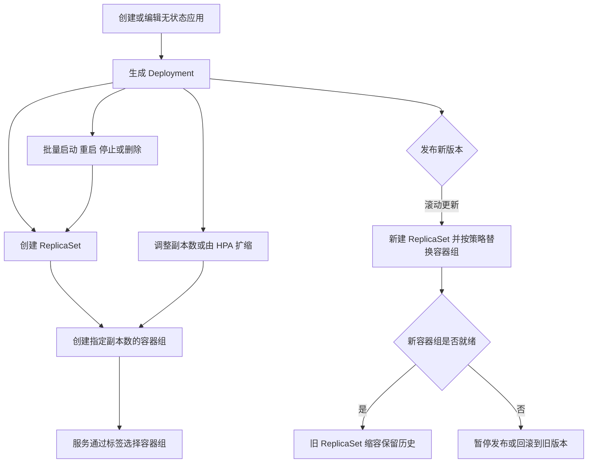
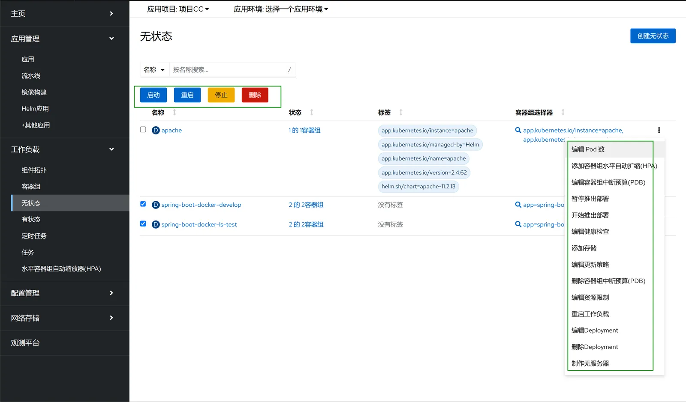
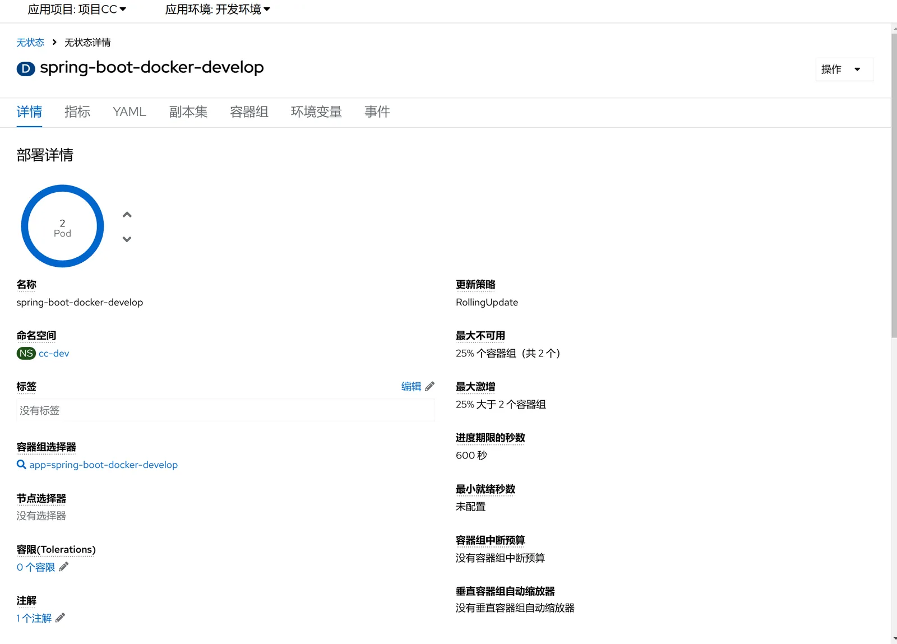
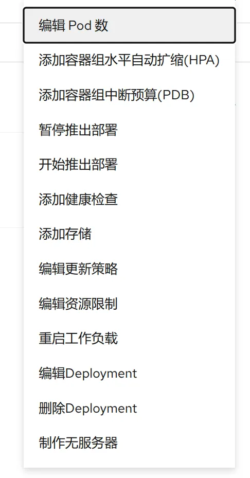

## 介绍

:::note

无状态应用（Deployment）用于管理和运行一组容器组，适用于不需要保持持久状态的负载。这种部署方式非常适合如Web服务和微服务等应用场景。
[更多信息](https://kubernetes.io/zh-cn/docs/concepts/workloads/controllers/deployment)

:::

## 对象关系与发布流程

## 无状态列表

:::note

在无状态列表上有个四个按钮，可以批量化操作无状态应用。

:::
 

| 按钮                       | 说明                                                                                  |
|:-------------------------|:------------------------------------------------------------------------------------|
| **启动** | 批量启动无状态应用，默认是启动两个副本，如果应用是通过批量停止的， 启动会恢复到停止前的副本数                                     |
| **重启** | 批量重启无状态应用，如果应用有多容器组，会根据应用的[更新策略](/docs/developer/workload-operations/update-strategy/)来重启 |
| **停止** | 批量停止无状态应用，在停止时会记录当前运行的副本数                                                           |
| **删除** | 批量删除无状态应用，需要键入`confirmed`进行确认                                                       |

## 访问无状态应用

:::note

点击访问单个无状态应用，可以看到以下菜单

:::

| 菜单   | 说明                                    |
|:-----|:--------------------------------------|
| 详情   | 无状态应用的详情                              |
| 指标   | 查看容器组的指标，可以同时查看多个容器组                  |
| YAML | 资源对象的YAML，用于高级用户                      |
| 副本集  | 无状态应用通过副本集进行版本控制，可以查看和管理无状态版本         |
| 容器组  | 属于这个无状态应用的容器组                         |
| 环境变量 | 属于这个无状态应用的环境变量                        |
| 事件   | [事件详情](/docs/observability/events/) |

## 操作无状态应用

- 点击列表右侧的`操作图标`或者点击无状态应用页面右上的`操作`，可以对当前无状态应用进行更多操作,其中大部分和[有状态应用](/docs/developer/workloads/statefulsets/)是相同的

| 菜单                     | 说明                                                                 |
|:-----------------------|:-------------------------------------------------------------------|
| 编辑容器组数量                | 编辑该无状态应用的副本数 [更多细节](/docs/developer/workload-operations/scale/)      |
| 添加/编辑/删除容器组水平自动扩缩(HPA) | 支持容器组水平自动扩缩 [更多细节](/docs/developer/workload-operations/hpa/)                  |
| 添加/编辑/删除容器组中断预算(PDB)   | 支持容器组中断预算 [更多细节](/docs/developer/workload-operations/pdb/)                    |
| 添加/编辑/删除健康检查           | 容器组健康检查 [更多细节](/docs/developer/workload-operations/health-checks/)       |
| 添加存储                   | 实现容器数据持久化 [更多细节](/docs/developer/workload-operations/add-storage/)            |
| 编辑更新策略                 | 编辑容器组更新策略  [更多细节](/docs/developer/workload-operations/update-strategy/)  |
| 编辑资源限制                 | 添加/编辑容器资源限制 [更多细节](/docs/developer/workload-operations/resource-limits/) |
| 编辑Deployment           | 编辑这个无状态应用，支持图形化和YAML两种模式                                           |
| 删除Deployment           | 删除这个无状态应用                                                          |

## 发布与回滚

Deployment 通过 ReplicaSet 保存版本历史。修改镜像、命令、环境变量或资源限制后，KDO 会按更新策略创建新的 ReplicaSet，并逐步替换旧 Pod。

| 策略 | 行为 | 适用场景 |
| --- | --- | --- |
| RollingUpdate | 逐步创建新 Pod、终止旧 Pod，可设置 `maxSurge` 和 `maxUnavailable` | 大多数无状态服务 |
| Recreate | 先终止所有旧 Pod，再创建新 Pod | 不能同时运行两个版本的应用 |

发布过程中可以在详情页查看 ReplicaSet 和 Pod 状态。新版本未就绪时，旧版本会保留；确认异常后可以回滚到上一个 ReplicaSet。

回滚前先确认：

- 数据库或外部依赖是否兼容旧版本。
- 是否需要同时回滚配置、Secret 或环境变量。
- 是否有正在运行的构建或迁移任务。

## 资源与健康检查

- 为容器设置 `requests` 和 `limits`，避免节点资源被单个应用耗尽。
- 配置 readinessProbe，确保只有就绪 Pod 接收流量。
- 配置 livenessProbe，进程卡死时可以自动重启。
- 为关键服务设置多个副本和 PodDisruptionBudget。
- 需要自动扩缩时配置 [HPA](/docs/developer/workload-operations/hpa/)。

## 常见问题

### Pod 一直 Pending

查看事件中的调度失败原因：节点资源不足、污点/容忍不匹配、亲和性规则过严或 PVC 未绑定。

### ImagePullBackOff

检查镜像地址、tag、镜像仓库凭据和网络；私有仓库需要正确的 `imagePullSecrets`。

### CrashLoopBackOff

查看容器日志和 `--previous` 日志，确认启动命令、配置文件、依赖服务和环境变量。

### 发布后没有流量

检查 readinessProbe、Service selector、Endpoints 和 Ingress 后端端口。

### 回滚后仍是新版本

确认回滚的是正确的 ReplicaSet，并检查是否有 HPA、GitOps 或流水线在持续覆盖副本数和镜像。

## 最佳实践

- 使用不可变镜像 tag 或 digest，不使用 `latest`。
- 把配置放进 ConfigMap/Secret，镜像保持环境无关。
- 为发布设置合理的 `maxUnavailable`，避免一次性下线过多实例。
- 在 CI 中先构建、扫描和测试，再更新 Deployment。
- 发布后观察错误率、延迟、重启次数和资源使用，再扩大流量。

## 相关文档

- [有状态应用（StatefulSet）](/docs/developer/workloads/statefulsets/)
- [容器组（Pod）](/docs/developer/workloads/pods/)
- [更新策略](/docs/developer/workload-operations/update-strategy/)
- [健康检查](/docs/developer/workload-operations/health-checks/)
- [资源限制](/docs/developer/workload-operations/resource-limits/)
- [排障索引](/docs/reference/troubleshooting/)
