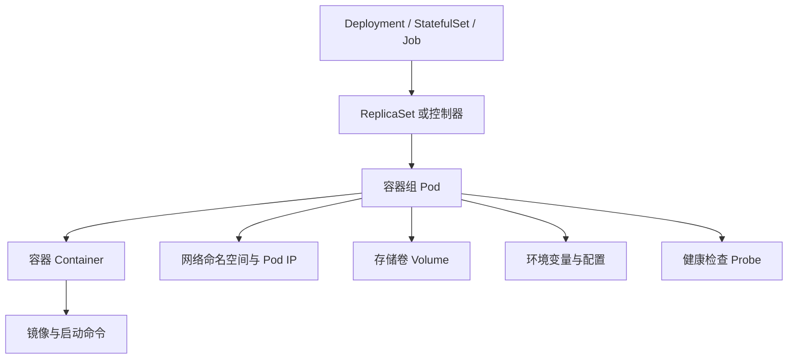
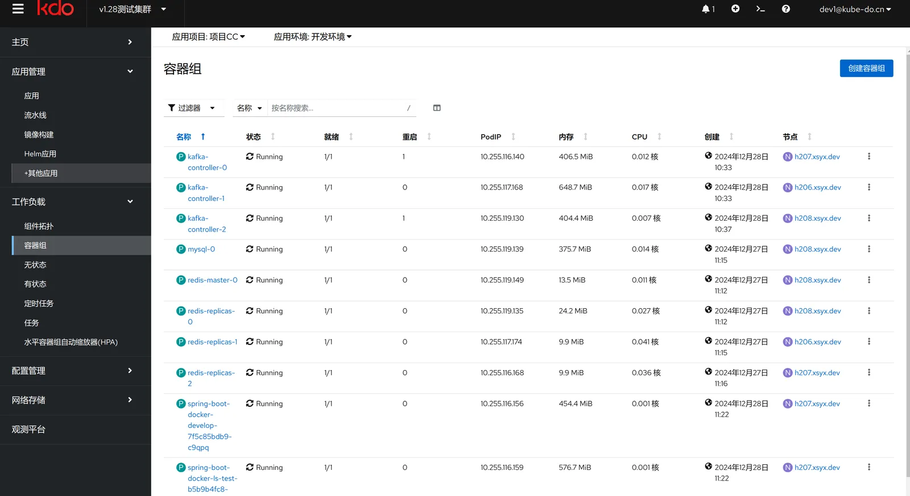
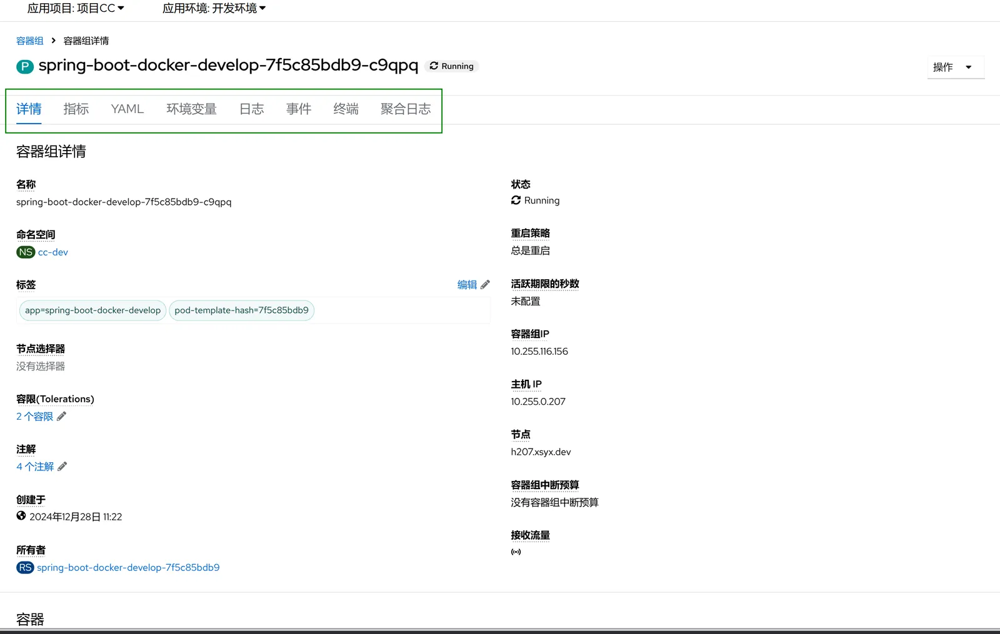
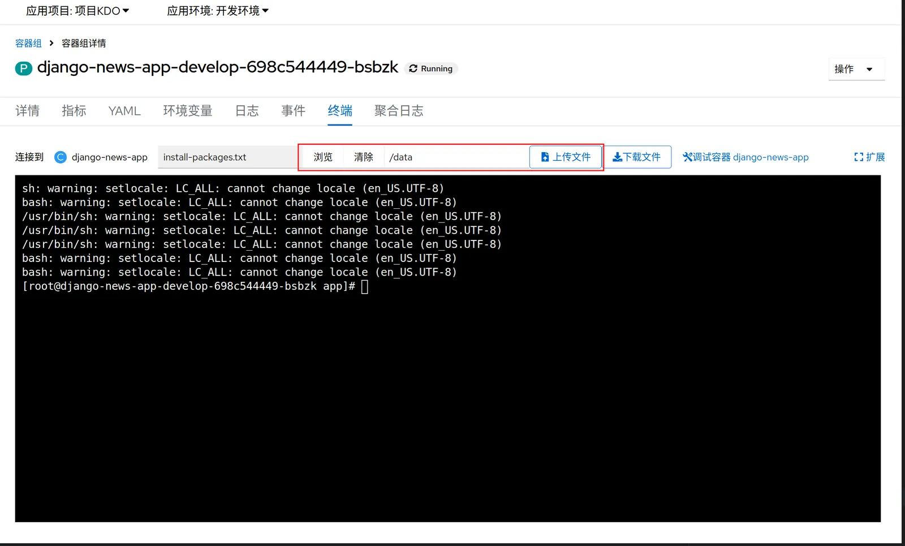
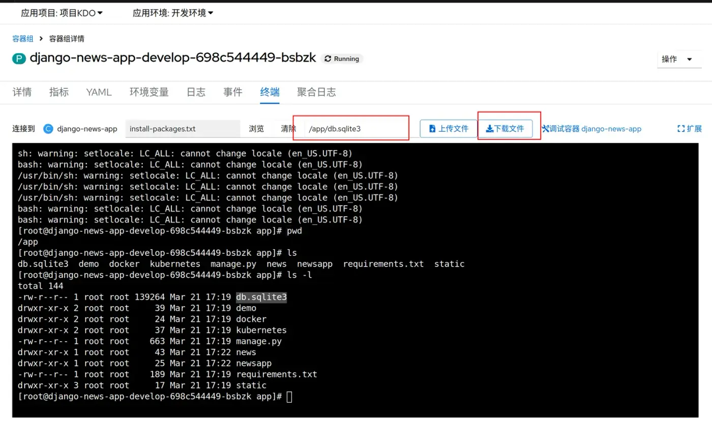
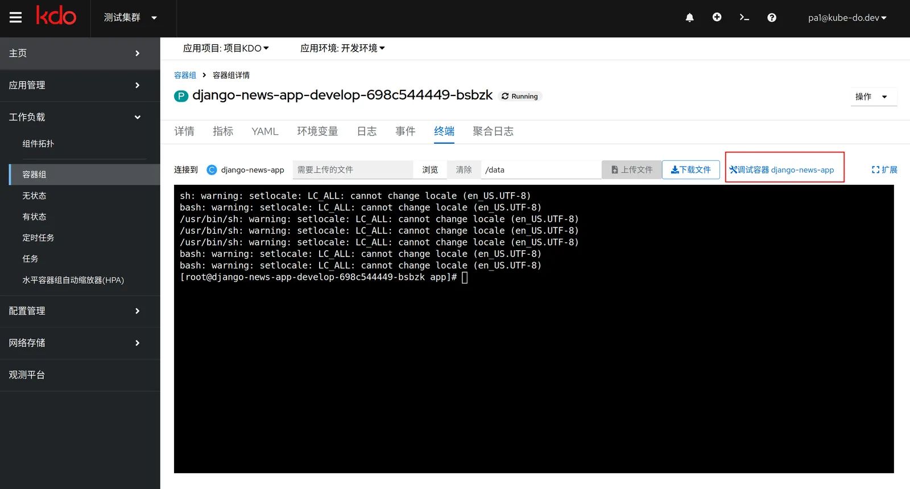
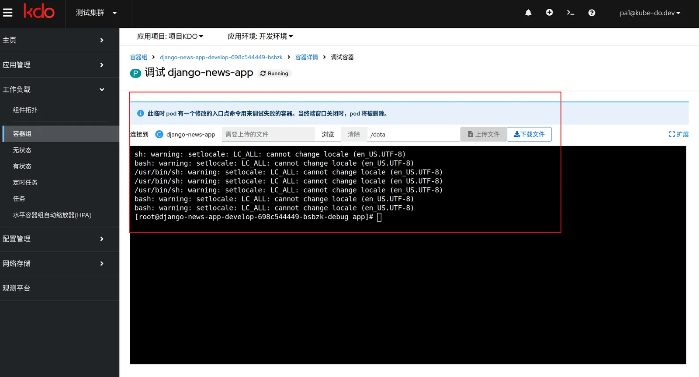

## 概念

容器组（Pod）是 Kubernetes 中最小的可部署单元。一个容器组可以包含一个或多个容器，这些容器：

- 共享同一个网络命名空间，因此可以通过 `localhost` 互相访问。
- 共享挂载的存储卷。
- 被调度到同一个节点上运行。

在实际使用中，通常不会直接创建容器组，而是通过 Deployment、StatefulSet、Job、CronJob 等工作负载控制器管理容器组。控制器负责副本数、滚动更新、重启和故障替换。

## 对象关系

## 生命周期与状态

容器组从创建到退出会经历多个阶段：

| 状态 | 含义 | 常见原因 |
|---|---|---|
| `Pending` | 已创建，但尚未调度或容器尚未启动 | 资源不足、节点亲和性不满足、镜像拉取中、PVC 未绑定 |
| `Running` | 已调度，至少一个容器正在运行 | 正常运行 |
| `Succeeded` | 所有容器成功退出 | Job 正常完成 |
| `Failed` | 至少一个容器以失败状态退出 | 启动命令错误、依赖不可用、OOM |
| `Unknown` | 无法获取容器组状态 | 节点失联、kubelet 异常 |

容器组内容器的重启行为由 `restartPolicy` 决定：

| 策略 | 行为 | 适用场景 |
|---|---|---|
| `Always` | 容器退出后总是重启 | Deployment、StatefulSet 等长期运行服务 |
| `OnFailure` | 仅失败退出时重启 | Job |
| `Never` | 不重启 | 一次性任务 |

## 查看容器组

在 **开发者界面 → 工作负载 → 容器组** 中可以看到当前项目环境下的容器组列表。

列表主要字段：

| 字段 | 说明 |
|---|---|
| 名称 | 容器组名称，通常由控制器生成 |
| 状态 | Pending、Running、Succeeded、Failed、Unknown |
| 就绪 | 就绪容器数 / 总容器数 |
| 重启次数 | 容器重启累计次数，异常升高通常意味着崩溃循环 |
| Pod IP | 容器组 IP，仅在集群网络内可直接访问 |
| 内存 / CPU | 当前资源使用量 |
| 创建时间 | 容器组创建时间 |
| 节点 | 容器组所在节点 |

点击容器组名称进入详情页，常用 Tab：

| Tab | 用途 |
|---|---|
| 详情 | 基本信息、状态条件、容器、存储卷、调度信息 |
| 指标 | CPU、内存、网络等实时指标 |
| YAML | 查看容器组完整定义 |
| 环境变量 | 查看容器环境变量和来源 |
| 日志 | 查看单个容器日志，支持实时跟随 |
| 事件 | 查看调度、拉取镜像、重启、OOM 等事件 |
| 终端 | 进入容器执行命令 |
| 聚合日志 | 按容器组聚合查看多个容器日志 |

<video class="doc-video" controls muted loop autoplay playsinline preload="metadata" poster="/media/docs/developer/workloads/pods/imgs/pod-poster.webp" aria-label="容器组操作演示"><source src="/media/docs/developer/workloads/pods/imgs/pod.mp4" type="video/mp4" /></video>

## 常用操作

### 查看日志

在详情页打开 **日志** Tab，选择容器后可以查看历史日志或实时日志。排查启动失败时，优先查看：

- 容器启动命令和参数是否正确。
- 依赖服务、数据库、配置中心是否可访问。
- 是否因为权限、Secret、ConfigMap 缺失导致启动失败。

需要跨多个容器组检索时，使用 [日志](/docs/observability/logging/) 页面。

### 进入终端

在 **终端** Tab 中可以直接进入容器。终端继承当前 KDO 账号权限，适合临时排查，不建议在容器内手工修改生产配置。

需要长期使用命令行时，可以使用 [CloudShell](/docs/developer/dev-environments/terminal/cloudshell/) 或 [LocalShell](/docs/developer/dev-environments/terminal/localshell/)。

### 上传和下载文件

容器组详情页支持上传和下载文件，适合临时拷入诊断脚本或导出日志。

生产环境建议通过镜像、ConfigMap 或对象存储分发文件，避免依赖手工上传。

### 调试容器组

KDO 提供调试容器组能力，用于在业务容器镜像缺少排查工具时，附加一个临时调试容器。

调试容器与业务容器共享网络和存储，可以直接使用 `curl`、`dig`、`tcpdump` 等工具定位问题。排查完成后应及时删除调试容器。

## 资源与健康检查

容器组是否稳定，主要取决于资源配置和健康检查：

- **资源请求与限制**：为容器设置 `requests` 和 `limits`，避免资源争抢和节点过载。参考 [资源限制](/docs/developer/workload-operations/resource-limits/)。
- **存活探针**：检测容器是否卡死，失败后重启容器。
- **就绪探针**：检测容器是否可以接收流量，未就绪时从 Service Endpoints 中移除。
- **启动探针**：为启动较慢的应用预留启动时间，避免被存活探针误杀。

健康检查配置参考 [健康检查](/docs/developer/workload-operations/health-checks/)。

## 故障排查

### 容器组一直 Pending

1. 查看 **事件**，确认是否为资源不足、节点亲和性、污点或 PVC 未绑定。
2. 检查命名空间 ResourceQuota 和 LimitRange 是否限制了调度。
3. 检查 PVC 是否处于 `Bound` 状态。
4. 检查节点是否可调度，是否存在 `nodeSelector`、`affinity`、`tolerations` 配置错误。

### ImagePullBackOff / ErrImagePull

1. 确认镜像地址、Tag 是否正确。
2. 确认镜像仓库凭据 Secret 是否存在，并已挂载到容器组。
3. 确认集群网络可以访问镜像仓库。
4. 私有仓库需要配置镜像拉取 Secret，参考 [镜像仓库配置](/docs/admin/platform-config/)。

### CrashLoopBackOff

1. 查看容器日志，确认启动命令、配置文件、依赖服务是否正常。
2. 查看事件，确认是否因为权限、Secret、ConfigMap、存储挂载失败。
3. 在本地使用相同镜像和启动命令复现。
4. 检查存活探针是否过于激进，导致应用尚未启动就被重启。

### OOMKilled

容器内存超过 `limits.memory` 会被内核终止，状态通常显示 `OOMKilled`。

- 提高内存限制，或优化应用内存占用。
- 检查是否存在内存泄漏、缓存无上限、批量任务并发过高等问题。
- 结合监控查看内存增长趋势，不要只临时调大限制。

### Evicted

节点资源压力过大时，Kubernetes 可能驱逐容器组。常见原因包括节点内存、磁盘、PID 压力。

- 查看节点状态和驱逐原因。
- 为关键业务设置合理的资源请求和优先级。
- 扩容节点或调整调度策略。

## 最佳实践

- **不要直接管理容器组**：使用 Deployment、StatefulSet、Job 等控制器管理副本和更新。
- **一个容器组一个主进程**：需要多个进程时，优先拆分为多个容器组，或使用 Sidecar 模式。
- **设置资源请求和限制**：避免资源争抢，也便于调度和容量规划。
- **配置健康检查**：存活、就绪、启动探针要按应用特性设置，避免误杀。
- **日志输出到标准输出**：由平台统一采集，不要在容器内写无限增长的日志文件。
- **不要把配置和密钥打进镜像**：使用 ConfigMap、Secret 和环境变量。
- **定期清理调试容器和临时文件**：避免影响业务容器和节点磁盘。

## 相关文档

- [工作负载概览](/docs/developer/workloads/)
- [无状态应用（Deployment）](/docs/developer/workloads/deployments/)
- [有状态应用（StatefulSet）](/docs/developer/workloads/statefulsets/)
- [健康检查](/docs/developer/workload-operations/health-checks/)
- [资源限制](/docs/developer/workload-operations/resource-limits/)
- [日志](/docs/observability/logging/)
- [事件](/docs/observability/events/)
