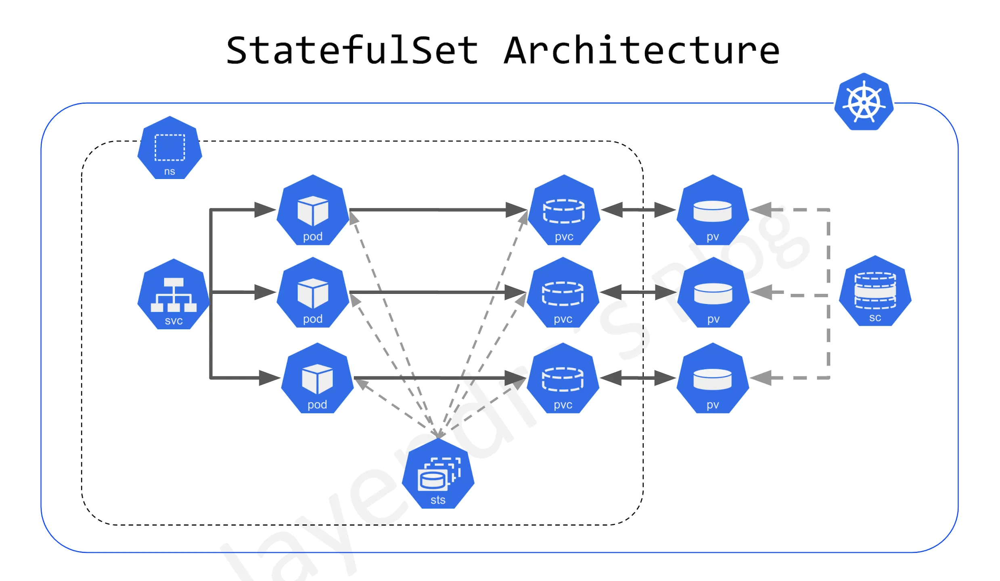
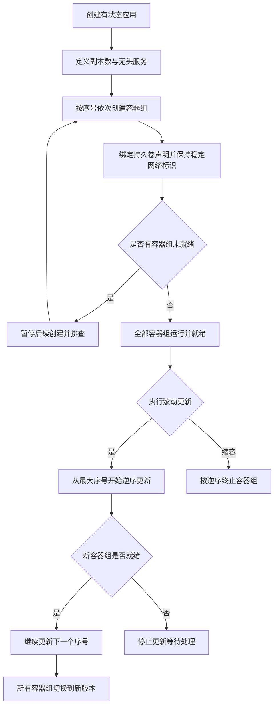
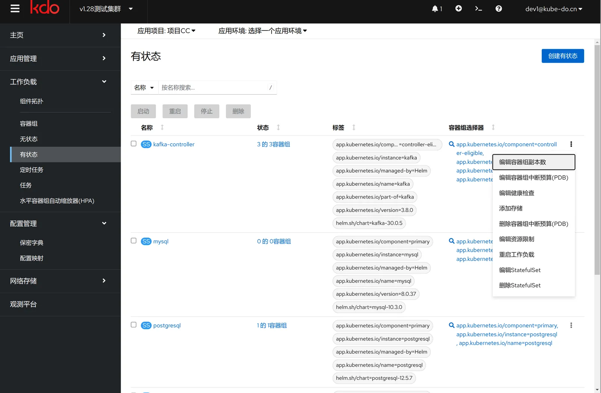
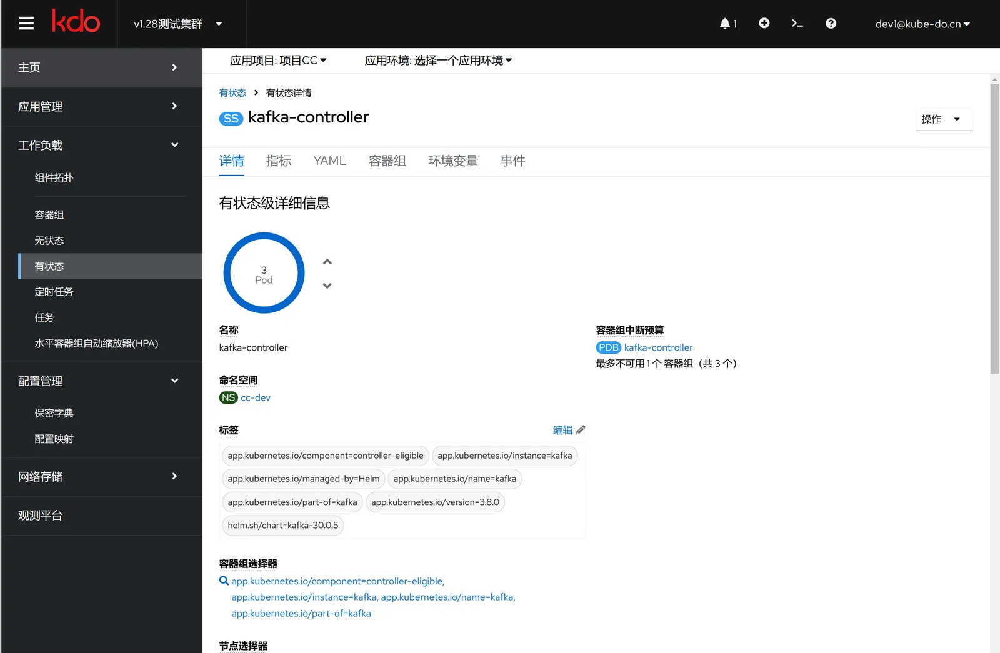
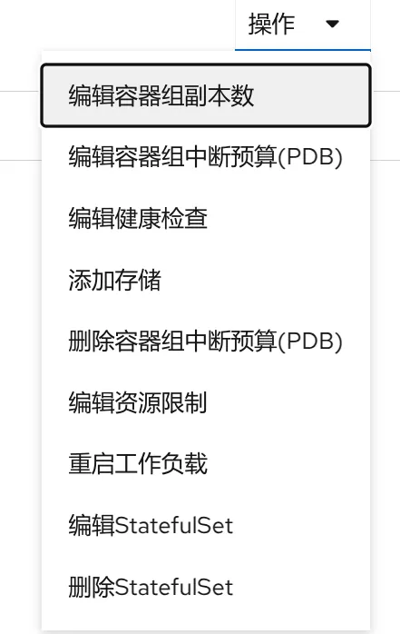

## 介绍

:::note

`有状态应用(StatefulSet)` 是 Kubernetes 中的一种工作负载 API 对象，用于管理有状态应用的部署和扩展。
与 [无状态应用(Deployment)](/docs/developer/workloads/deployments/) 不同的是，`有状态应用(StatefulSet)` 为每个 `容器组(Pod)` 提供了稳定的、唯一的网络标识符，并且保证有序的、优雅的部署和缩放。
这意味着当你创建一个 `有状态应用(StatefulSet)` 来管理一组 `容器组(Pod)` 时，每个 容器组(Pod) 都会有一个持久的身份，即使它被重新调度到集群中的其他节点上。
使用`状态应用(StatefulSet)`的典型场景包括数据库（如 MySQL、PostgreSQL）、缓存系统（如 Redis 集群）和其他需要持久存储和稳定网络标识的应用程序。

:::



## 部署与更新流程



## 关键特性
1. **稳定的网络身份:** 每个 Pod 在 StatefulSet 中都有一个基于其序号的固定名称（例如，web-0、web-1），这个名称在 Pod 整个生命周期中保持不变，即使 Pod 被删除和重建。
2. **持久存储:** 通常与 有状态应用(StatefulSet) 一起使用的是 PersistentVolume(PV) 和 PersistentVolumeClaim(PVC)。当 StatefulSet 创建 Pod 时，这些卷声明会被绑定到特定的持久卷，确保数据可以在 Pod 重启或重新调度后仍然存在。
3. **有序部署和扩展:** 有状态应用(StatefulSet) 确保按顺序创建 Pod，并且只有在前一个 Pod 成功启动并运行之后才会继续下一个。同样，在缩放过程中，Pod 按照逆序终止。
4. **有序地滚动更新:** 有状态应用(StatefulSet) 支持滚动更新，但与 Deployments 不同，它按照反向顺序进行更新（从最后一个 Pod 开始），并且在确认每个新版本的 Pod 正常运行之前不会继续更新下一个。
5. **无头服务(Headless Service):** 通常会为 状态应用(StatefulSet) 创建一个特殊的无头服务（Headless Service），用于命名和发现 Pod。由于 StatefulSet 的 Pod 拥有稳定的身份，所以它们可以通过这个服务来访问彼此。


## 有状态列表



:::note

在有状态列表上有个四个按钮，可以批量化操作有状态应用。

:::


| 按钮                       | 说明                                                                                 |
|:-------------------------|:-----------------------------------------------------------------------------------|
| **启动** | 批量启动有状态应用，默认是启动一个副本，如果应用是通过批量停止的， 启动会恢复到停止前的副本数                                    |
| **重启** | 批量重启有状态应用                                                                          |
| **停止** | 批量停止有状态应用，在停止时会记录当前运行的副本数                                                          |
| **删除** | 批量删除有状态应用，需要键入`confirmed`进行确认                                                      |

## 访问有状态应用

:::note

有状态应用的访问页面基本和无状态应用一样，可以参考[访问无状态应用](/docs/developer/workloads/deployments/#访问无状态应用)

:::




## 操作有状态应用

:::note

操作有状态应用基本也和无状态应用一样，只是有些不适合有状态应用菜单没有显示，可以参考[操作无状态应用](/docs/developer/workloads/deployments/#操作无状态应用)

:::



## 什么时候使用 StatefulSet

适合：

- 数据库、消息队列、缓存集群等需要稳定身份的应用。
- 每个实例需要独立持久卷，且重启后保持同一份数据。
- 实例之间有启动顺序或主从关系。
- 需要通过稳定 DNS 名称访问特定实例。

不适合：

- 完全无状态、实例可以随意替换的 Web 服务。
- 不需要稳定网络标识的批处理任务。
- 只需要共享存储、不需要实例身份的应用。

## 网络身份与存储

StatefulSet 通常配合 Headless Service 使用：

```yaml
apiVersion: v1
kind: Service
metadata:
  name: mysql-headless
spec:
  clusterIP: None
  selector:
    app: mysql
  ports:
    - name: mysql
      port: 3306
```

每个 Pod 的 DNS 名称形如：

```text
<pod-name>.<headless-service>.<namespace>.svc.cluster.local
```

`volumeClaimTemplates` 会为每个副本创建独立 PVC，命名通常是 `<模板名>-<pod-name>`。删除 StatefulSet 不会自动删除 PVC；需要先确认数据不再使用，再手工清理。

## 更新与扩缩容

- 默认按序号从大到小滚动更新，前一个 Pod 就绪后才继续。
- `podManagementPolicy: OrderedReady` 保证有序；`Parallel` 适合实例之间没有依赖的场景。
- 缩容按序号从大到小终止 Pod，PVC 默认保留。
- 扩容时新 Pod 会按序号创建，并绑定新的 PVC。

更新前确认存储、备份和主从切换方案；数据库类应用不要直接依赖滚动更新完成版本升级。

## 常见问题

### Pod 一直 Pending

检查 PVC 是否绑定、StorageClass 是否支持 `ReadWriteOnce`、节点是否有足够资源，以及 Pod 的亲和性和 tolerations。

### 新 Pod 启动顺序卡住

前一个 Pod 未 Ready 时，`OrderedReady` 不会继续创建后续 Pod。先排查前一个 Pod 的日志、探针和存储。

### 删除后数据丢失

删除 PVC 或 StatefulSet 时误删了持久卷。确认回收策略和备份；StatefulSet 本身不会自动删除 PVC。

### 无法通过稳定域名访问

确认 Headless Service 的 selector 与 Pod 标签一致，并检查 Pod 是否 Ready。

## 最佳实践

- 为每个实例使用独立 PVC，不要多个副本共享同一个 `ReadWriteOnce` 卷。
- 为数据库配置备份、恢复演练和主从切换方案。
- 使用反亲和性尽量分散副本，避免单节点故障。
- 缩容前先迁移数据或确认副本角色。
- 为关键实例配置 PDB，避免维护时同时中断多个副本。

## 相关文档

- [无状态应用（Deployment）](/docs/developer/workloads/deployments/)
- [容器组（Pod）](/docs/developer/workloads/pods/)
- [PVC](/docs/developer/network-storage/pvc/)
- [存储](/docs/admin/storage/)
- [排障索引](/docs/reference/troubleshooting/)
