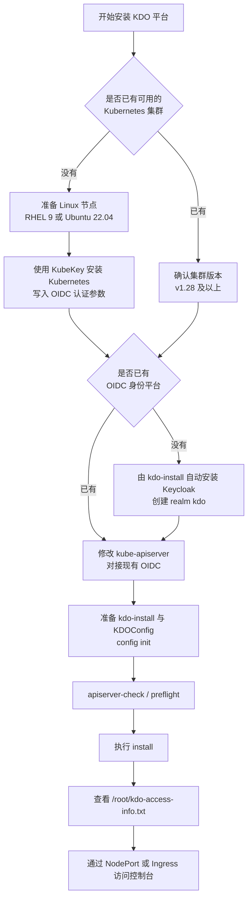
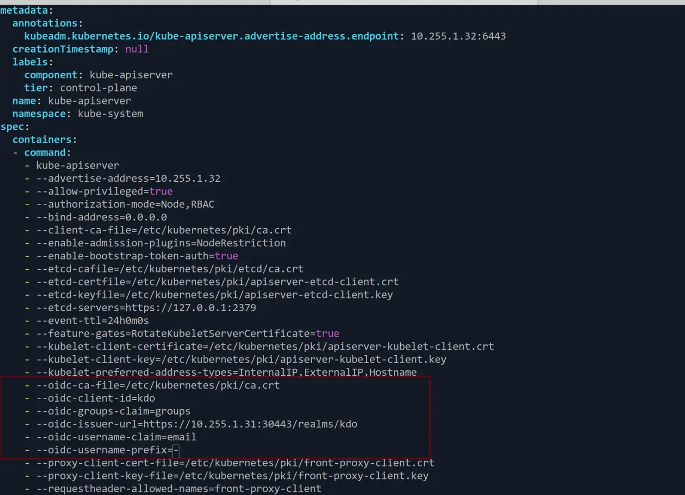

:::note

对于 Linux 环境下的安装，KDO 平台既支持云端部署也支持本地部署，包括虚拟机和物理服务器等多种形式。
安装 KDO 平台有两种主要模式：

:::

- **无现有 Kubernetes 集群**：先在 Linux 上安装 Kubernetes，再安装 KDO 平台。
- **已有 Kubernetes 集群**：确认集群版本满足要求，配置 kube-apiserver 的 OIDC 参数后直接安装 KDO 平台。


## 工作流程



## 在现有的 Linux 操作系统安装 KDO 平台

推荐使用 RHEL 9（AlmaLinux 9/Rocky 9）或 Ubuntu 22.04 及以上版本。主要分为以下三个部分：

1. [安装 Kubernetes 集群](./kubernetes)
2. [安装 Keycloak](./keycloak)
3. [安装 KDO 平台](./kdo)


## 在现有的 Kubernetes 集群上安装 KDO 平台

如果已经有 Kubernetes 集群（v1.28 以上），只需要配置 OIDC 并安装 KDO 平台：

1. [根据 OIDC 平台设置 Kubernetes](#configure-kubernetes-oidc)
2. [安装 KDO 平台](./kdo)


## 根据 OIDC 平台设置 Kubernetes {#configure-kubernetes-oidc}

:::note

通过 `vim` 打开 `/etc/kubernetes/manifests/kube-apiserver.yaml`，在 `spec.containers.command` 中添加 OIDC 参数。
如果使用其他 OIDC Provider，请按其文档调整参数。[更多信息](https://kubernetes.io/zh-cn/docs/reference/access-authn-authz/authentication/)

:::

```shell
vim /etc/kubernetes/manifests/kube-apiserver.yaml
```



### 修改 API Server 参数

```yaml
spec:
  containers:
  - command:
    # 在末尾添加以下参数；如果已经存在，需要修改为一致的值
    - --oidc-client-id=kdo
    - --oidc-groups-claim=groups
    - '--oidc-groups-prefix=kdo:'
    - --oidc-issuer-url=https://${NodeIP}:30443/realms/kdo
    - --oidc-username-claim=preferred_username
    - --oidc-username-prefix=-
    # 可选：issuer 使用私有 CA 时建议配置
    - --oidc-ca-file=/etc/kubernetes/pki/ca.crt
```

:::warning

如果有多个 Master 节点，每个 Master 节点都需要修改，并保证参数完全一致。

:::

安装器会通过 `kdo-install apiserver-check` 检查上述参数。`--oidc-ca-file` 不是强制项；未配置时使用系统根证书，安装了内置 Keycloak 的集群建议保留该参数。

## 平台组件访问

KDO 由多个开源组件组成，默认通过 NodePort 访问。安装完成后，安装器会把实际地址、管理员账号和动态密码写入：

```text
/root/kdo-access-info.txt
```

NodePort 是默认访问方式。安装器还会额外创建 Ingress，地址形如 `https://console.<domain>`；使用前需要在 DNS 中添加记录，或在客户端 `/etc/hosts`（Windows 为 `C:\Windows\System32\drivers\etc\hosts`）中配置解析。

### 默认项目

KDO 平台默认创建项目 `kdo`，包含 `开发(dev)`、`测试(test)`、`预发(stage)`、`生产(prod)` 四个环境。

内置 Keycloak 会创建四个演示用户：

| 用户 | 角色 |
| --- | --- |
| `pa1` | 项目管理员 |
| `dev1` | 项目开发者 |
| `qa1` | 项目测试人员 |
| `ops1` | 项目运维人员 |

这些用户的密码在安装时动态生成，记录在 `/root/kdo-access-info.txt` 的“演示用户”段落中，不再使用固定默认密码。

假设集群的 `NODE_IP` 是 **10.22.1.20**，默认域名后缀是 **kube-do.dev**，访问地址如下：

| 控制台 | 功能 | 默认访问地址 | 账号 |
| --- | --- | --- | --- |
| KDO 平台控制台 [管理员页面](/docs/admin) [开发者页面](/docs/developer/) | KDO 整体功能管理 | `http://${NODE_IP}:30080`，例如 <http://10.22.1.20:30080> | Keycloak 管理员，见访问信息文件 |
| Keycloak 控制台 | OIDC 认证管理、用户管理 | `https://${NODE_IP}:30443`，例如 <https://10.22.1.20:30443> | `admin`，密码见访问信息文件 |
| Harbor 控制台 | 镜像仓库管理 | `http://${NODE_IP}:30002`，例如 <http://10.22.1.20:30002> | `admin`，密码见访问信息文件 |
| Grafana 控制台 | 告警、监控、日志高级功能 | `http://grafana.${DEFAULT_DOMAIN}`，例如 <http://grafana.kube-do.dev> | `admin`，密码见访问信息文件 |

Ingress 地址示例：

| 组件 | 地址 |
| --- | --- |
| Console | `https://console.kube-do.dev` |
| Keycloak | `https://keycloak.kube-do.dev` |
| Harbor | `https://harbor.kube-do.dev` |
| Grafana | `https://grafana.kube-do.dev` |
| Pipelines as Code | `https://pac.kube-do.dev` |
| MinIO Console | `https://minio.kube-do.dev` |

:::note

访问信息文件包含明文密码，权限为 `0600`。请妥善保管，并在首次登录后按组织安全要求修改管理员密码。

:::
