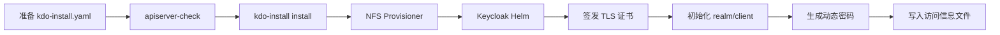

## 安装 Keycloak

KDO 的 Console、Kubernetes 用户认证依赖 OIDC。默认安装方式由 `kdo-install` 自动完成，不再需要手工执行 Helm、签发证书或使用 `kcadm` 创建 realm。

Keycloak 负责：

- 提供 KDO 的 OIDC Issuer。
- 提供 Console 登录。
- 提供 Kubernetes 用户与用户组身份。
- 保存演示用户 `pa1`、`dev1`、`qa1`、`ops1`。

## 工作流程



## 1. 前置条件

- Kubernetes 控制面可用，当前节点可执行 `kubectl`。
- 安装器在控制面节点以 root 运行。
- kube-apiserver 的 OIDC 参数已按 KDO 要求配置，或准备使用外部 OIDC。

检查 OIDC 参数：

```bash
kdo-install apiserver-check -config kdo-install.yaml
```

相关参数：

```text
--oidc-issuer-url=https://<NodeIP>:30443/realms/kdo
--oidc-client-id=kdo
--oidc-username-claim=preferred_username
--oidc-username-prefix=-
--oidc-groups-claim=groups
--oidc-groups-prefix=kdo:
```

`--oidc-ca-file` 不是强制项。检查器只校验参数，不检查 Keycloak 是否已经可连接；安装阶段 Keycloak 可能尚未部署。

## 2. 使用内置 Keycloak

使用内置 Keycloak 时，`spec.oidc.issuerURL` 保持默认或指向本集群：

```yaml
spec:
  cluster:
    nodeIP: "10.255.1.31"
    domain: "kube-do.dev"
  oidc:
    issuerURL: "https://10.255.1.31:30443/realms/kdo"
    clientID: "kdo"
    clientSecret: ""
  credentials:
    secretName: "kdo-credentials"
    bootstrap:
      keycloakAdminUser: "admin"
      keycloakAdminPassword: ""
      demoUserPassword: ""
      oidcClientSecret: ""
```

密码和 secret 留空时，安装器会自动生成，并保存到：

```text
kubedo-system/kdo-credentials
```

已有 Secret 时安装器复用原值，不会覆盖。

执行安装：

```bash
kdo-install install -config kdo-install.yaml -yes
```

安装器会自动完成：

1. 安装 NFS Provisioner，为 Keycloak 提供存储。
2. 通过 Helm 安装 Keycloak。
3. 使用集群 CA 签发 `*.<domain>` 证书，替换 Keycloak 默认证书。
4. 等待 Keycloak Admin API 就绪。
5. 等待 `kdo` realm 和 OIDC client 初始化完成。
6. 将 OIDC client secret 同步为 `kdo-credentials` 中的值。
7. 将 `pa1`、`dev1`、`qa1`、`ops1` 的密码重置为动态密码。
8. 将管理员密码、演示用户密码和访问地址写入 `/root/kdo-access-info.txt`。

Keycloak 首次启动需要初始化数据库和导入 realm，镜像拉取慢时可能超过 5 分钟。默认等待时间为 15 分钟，可通过配置或命令行调整：

```yaml
spec:
  install:
    timeout: 900s
```

```bash
kdo-install install -config kdo-install.yaml -timeout 30m -yes
```

## 3. 使用外部 OIDC

如果集群已接入外部 SSO（例如已有的 Keycloak、Casdoor 或其他 OIDC Provider），可以跳过内置 Keycloak：

```yaml
spec:
  oidc:
    issuerURL: "https://sso.example.com/realms/kdo"
    clientID: "kdo"
    clientSecret: "由外部 OIDC 平台提供"
```

同时确保 kube-apiserver 使用同一个 issuer 和 clientID，然后跳过内置 Keycloak：

```bash
kdo-install install -config kdo-install.yaml -skip keycloak -yes
```

外部 OIDC 需要满足：

- `issuerURL` 可被 kube-apiserver 访问。
- client 已配置正确的回调地址。
- token 中包含 `preferred_username` 和 `groups`。
- 用户组前缀与 `--oidc-groups-prefix` 一致，默认 `kdo:`。

使用外部 OIDC 时，安装器不会创建本地 Keycloak 用户，也不会修改外部平台的密码。访问信息文件中的演示用户密码可能不适用。

## 4. 访问 Keycloak

NodePort 是默认访问方式：

```text
https://<NodeIP>:30443
```

如果启用了 Ingress，还会创建：

```text
https://keycloak.<domain>
```

Ingress 需要 DNS 解析或客户端 hosts 配置。证书由集群 CA 签发，浏览器需要信任集群 CA。

查看地址和密码：

```bash
cat /root/kdo-access-info.txt
```

或重新生成：

```bash
kdo-install access-info -config kdo-install.yaml
```

## 5. 验证安装

检查 Pod：

```bash
kubectl -n kubedo-system get pods
```

检查 Keycloak 服务：

```bash
kubectl -n kubedo-system get svc keycloak
```

检查 realm：

```bash
curl -k https://<NodeIP>:30443/realms/kdo/.well-known/openid-configuration
```

检查 OIDC 登录：

1. 打开 Console。
2. 使用访问信息文件中的 Keycloak 管理员账号登录。
3. 确认可以进入 KDO 控制台。

## 6. Keycloak Web 页面设置

如果需要调整登录主题、用户属性或客户端配置，可以登录 Keycloak 管理控制台：

```text
https://<NodeIP>:30443/admin
```

管理员账号和密码在 `/root/kdo-access-info.txt` 中。

KDO 默认使用：

- Realm：`kdo`
- Client ID：`kdo`
- 用户名字段：`preferred_username`
- 用户组字段：`groups`
- 用户组前缀：`kdo:`

修改这些值会同时影响 Kubernetes 身份和 Console 登录，必须与 kube-apiserver 参数保持一致。

## 7. 常见问题

### Keycloak 一直等待初始化

首次安装需要拉取镜像并初始化数据库。确认 Pod 状态：

```bash
kubectl -n kubedo-system get pods -l app.kubernetes.io/name=keycloak
kubectl -n kubedo-system logs keycloak-0
```

如果镜像拉取较慢，调大超时：

```bash
kdo-install install -config kdo-install.yaml -timeout 30m -yes
```

### 查询 Keycloak client 超时

安装器会等待 `kdo` realm 和 client 创建完成。日志出现：

```text
等待 Keycloak realm/client 初始化 ...
```

属正常现象。超过等待时间后应检查 Keycloak 初始化容器和 Pod 日志。

### 浏览器提示证书不受信任

内置 Keycloak 使用集群 CA 签发证书。将集群 CA 加入客户端信任，或使用受信任的证书替换 `kubedo-system/keycloak-crt`。

### 外部 OIDC 登录失败

确认：

- kube-apiserver 与 KDOConfig 的 issuer、clientID 完全一致。
- `--oidc-username-claim=preferred_username`。
- `--oidc-groups-prefix=kdo:`。
- 外部平台返回的 groups 与 KDO 项目组命名一致。

## 继续安装 KDO 平台组件

Keycloak 就绪后，可以继续执行完整安装：

```bash
kdo-install install -config kdo-install.yaml -yes
```

重复执行同一命令可安全续跑，安装器会跳过已安装的 Helm release，并继续安装 Harbor、Tekton、Prometheus、Logging、Console 等组件。
