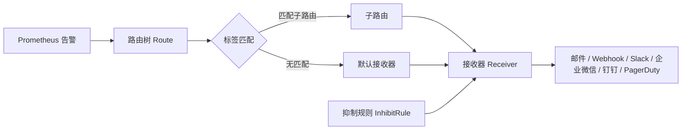
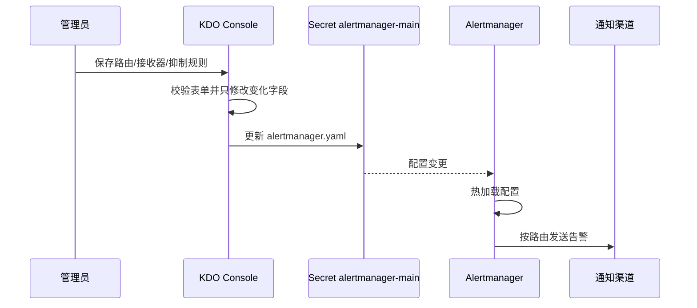

## 适用场景

当集群已经接入 Prometheus 告警规则，需要把告警按项目、环境或严重级别发送给不同团队时，使用本页配置 Alertmanager。

典型场景：

- 按 `namespace`、`severity`、`app` 等标签把告警路由到不同接收器。
- 配置邮件、Webhook、Slack、企业微信、钉钉或 PagerDuty 通知。
- 用抑制规则压掉由同一个根因引发的重复告警。
- 通过 YAML 编辑器维护子路由、模板等复杂配置。

## 前置条件

- 已安装 KDO 可观测性组件，Prometheus 与 Alertmanager 正常运行。
- 具有集群管理员或可观测性管理员权限。
- 已确认通知渠道的地址、账号或 Webhook 可用。
- 邮件通知需要可访问的 SMTP 服务；企业微信、钉钉需要对应的机器人 Webhook。

## 配置入口

在 KDO 控制台进入 **可观测性 → 告警配置**，打开 Alertmanager 配置页。

页面提供两个入口：

| 入口 | 适用场景 |
|---|---|
| **Details** | 表单化配置路由、全局参数、抑制规则和接收器，适合日常运维 |
| **YAML** | 直接编辑完整 Alertmanager 配置，适合子路由、模板等高级场景 |

配置最终保存在 Alertmanager 所在命名空间的 Secret 中，默认是 `monitoring/alertmanager-main`。部分集群使用 `openshift-monitoring` 命名空间，以实际部署为准。

## 核心概念

| 对象 | 作用 |
|---|---|
| **Route** | 根据标签把告警分配到接收器，并控制分组和发送节奏 |
| **Receiver** | 告警的发送目的地，一个接收器可以包含一种或多种通知方式 |
| **InhibitRule** | 当某类告警已经触发时，抑制另一类相关告警 |
| **Global** | SMTP、PagerDuty URL 等跨接收器共享的默认参数 |
| **Template** | 自定义通知标题和正文的模板文件 |

## 配置告警路由 {#routing}

路由决定“哪条告警发给谁”。在 **Details → Alert Routing** 中编辑。

| 字段 | 说明 |
|---|---|
| **Receiver** | 默认接收器；没有子路由匹配时使用 |
| **Group by** | 分组标签，例如 `namespace`、`alertname`、`severity` |
| **Group wait** | 新告警组首次发送前的等待时间，用于合并同一批告警 |
| **Group interval** | 同一分组内新告警再次发送的间隔 |
| **Repeat interval** | 同一告警持续触发时的重复通知间隔 |
| **Matchers** | 子路由匹配条件，例如 `severity="critical"` |

建议：

- 至少按 `namespace` 分组，避免不同项目的告警互相淹没。
- 严重级别高的告警使用更短的 `group_wait` 和 `repeat_interval`。
- 子路由条件从具体到宽泛，最后保留默认接收器兜底。
- 修改路由后先用一条测试告警验证，再逐步扩大匹配范围。

## 配置接收器 {#receivers}

在 **Details → Receivers** 中创建或编辑接收器。接收器名称需要唯一，并至少配置一种通知方式。

### 邮件（Email）

| 字段 | 必填 | 说明 |
|---|---|---|
| To | 是 | 收件人地址，多个地址用逗号分隔 |
| From | 是 | 发件人地址 |
| SMTP smarthost | 是 | SMTP 地址和端口，例如 `smtp.example.com:587` |
| Auth username | 否 | SMTP 认证用户名 |
| Auth password | 否 | SMTP 认证密码 |
| Require TLS | 否 | 是否要求 TLS |
| Send resolved | 否 | 告警恢复时是否发送通知 |

### Webhook

| 字段 | 必填 | 说明 |
|---|---|---|
| URL | 是 | 接收 POST 请求的 HTTP 端点 |
| Send resolved | 否 | 告警恢复时是否发送通知 |

Webhook 请求体为 Alertmanager 标准 JSON，适合接入自建通知网关或自动化平台。

### Slack

| 字段 | 必填 | 说明 |
|---|---|---|
| Webhook URL | 是 | Slack Incoming Webhook 地址 |
| Channel | 否 | 目标频道，例如 `#alerts` |
| Username | 否 | 发送者显示名称 |
| Send resolved | 否 | 告警恢复时是否发送通知 |

### 企业微信（WeChat Work）

| 字段 | 必填 | 说明 |
|---|---|---|
| Webhook URL | 是 | 企业微信群机器人 Webhook |
| Message type | 否 | 文本或 Markdown |
| Send resolved | 否 | 告警恢复时是否发送通知 |

### 钉钉（DingTalk）

| 字段 | 必填 | 说明 |
|---|---|---|
| Webhook URL | 是 | 钉钉群机器人 Webhook |
| Secret | 否 | 加签密钥；开启加签时必填 |
| Send resolved | 否 | 告警恢复时是否发送通知 |

钉钉在 Alertmanager 中没有原生 `dingtalk_configs`，KDO 会把钉钉配置映射为 `webhook_configs`，由通知网关转换消息格式。

### PagerDuty

| 字段 | 必填 | 说明 |
|---|---|---|
| Integration type | 是 | Events API v2 或 Prometheus |
| Routing key | 条件必填 | Events API v2 使用 |
| Service key | 条件必填 | Prometheus 集成使用 |
| PagerDuty URL | 是 | 默认 `https://events.pagerduty.com/v2/enqueue` |
| Severity | 否 | 告警严重级别 |
| Send resolved | 否 | 告警恢复时是否发送通知 |

## 配置抑制规则 {#inhibit}

抑制规则用于“已经有更严重的告警时，不再发送次要告警”。例如节点下线时，抑制该节点上所有 Pod 的重复告警。

| 字段 | 说明 |
|---|---|
| **Source matchers** | 触发抑制的源告警条件 |
| **Target matchers** | 被抑制的目标告警条件 |
| **Equal** | 源告警和目标告警必须相同的标签，例如 `namespace`、`instance` |

配置时先确定根因告警，再选择受影响的告警范围。`Equal` 不要留空，否则可能抑制范围过大。

## 使用 YAML 编辑器 {#yaml}

切换到 **YAML** 标签页可以直接编辑完整配置，适合以下场景：

- 配置多级子路由。
- 引用自定义通知模板。
- 批量调整接收器。
- 从现有 Alertmanager 迁移配置。

保存前确认：

1. YAML 缩进和字段名正确。
2. 接收器名称与路由引用一致。
3. Secret 中的配置没有被其他控制器覆盖。
4. 保存后 Alertmanager 能正常热加载，无配置错误日志。

:::warning

YAML 编辑器会写入完整配置。手工删除字段前先备份，避免覆盖平台自动维护的全局参数。

:::

## 配置如何生效

表单保存时只更新发生变化的字段，避免覆盖手工维护的其他配置。保存成功后不需要重启 Alertmanager Pod。

## 验证

1. 在 **可观测性 → 告警配置** 确认路由和接收器已保存。
2. 在 Prometheus 或告警规则页面触发一条测试告警。
3. 在 **可观测性 → 事件** 查看告警是否进入 Firing。
4. 检查接收器是否收到通知；邮件检查垃圾箱和 SMTP 日志。
5. 如果未收到，先确认告警标签是否匹配路由的 matchers。

## 常见问题

### 告警没有发送到任何接收器

- 检查告警标签是否匹配子路由的 matchers。
- 检查默认接收器是否存在。
- 检查接收器名称是否与路由引用的名称完全一致。
- 查看 Alertmanager 日志中是否有配置加载或通知发送错误。

### 通知重复或过多

- 增大 `group_interval` 或 `repeat_interval`。
- 调整 `group_by`，把同一类告警合并到一个分组。
- 为根因告警配置抑制规则，压掉衍生告警。

### 修改后没有生效

- 确认保存的是 Alertmanager 所在命名空间的 Secret。
- 检查是否有其他控制器覆盖了 `alertmanager.yaml`。
- 查看 Alertmanager 日志中的配置热加载结果。
- 确认浏览器没有缓存旧页面。

### 邮件发送失败

- 确认 SMTP 地址、端口、用户名和密码正确。
- 确认集群网络可以访问 SMTP 服务。
- 检查是否需要 TLS，以及发件人地址是否被 SMTP 服务允许。
- 查看 Alertmanager 日志中的 SMTP 错误。

## 相关链接

- [监控与告警规则](/docs/observability/monitoring/)
- [事件与告警历史](/docs/observability/events/)
- [通知中心](/docs/admin/notifications/)
- [日志检索](/docs/observability/logging/)
- [可观测性概览](/docs/observability/)
