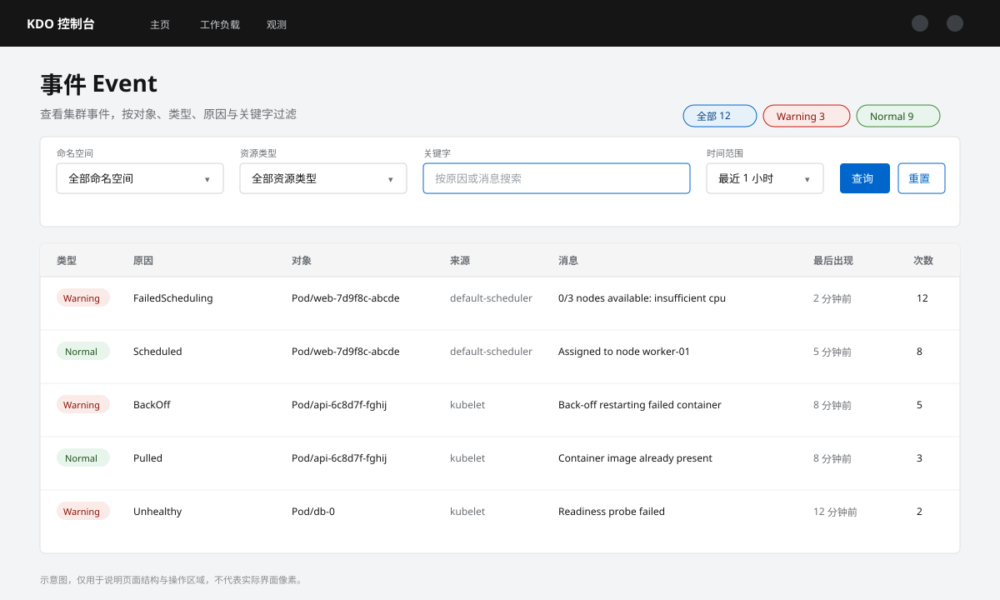
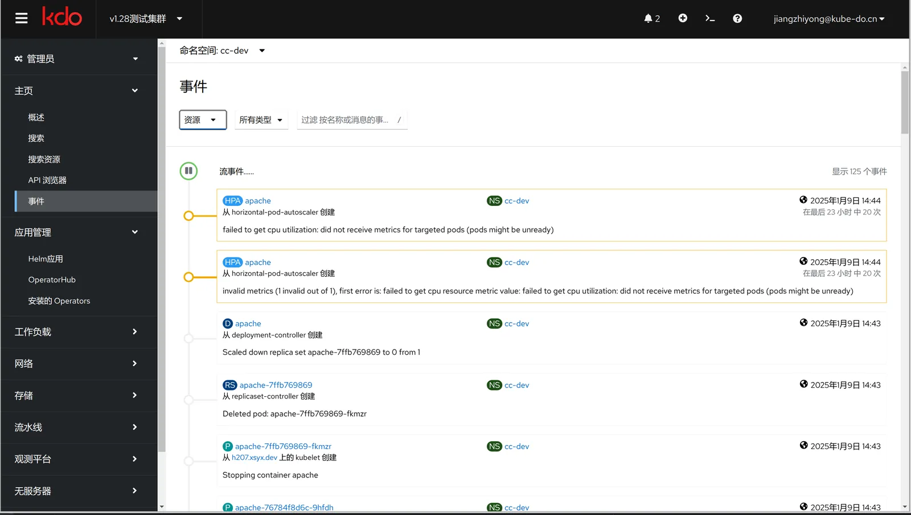
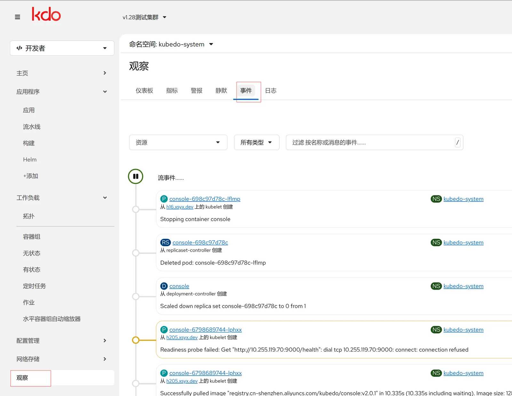
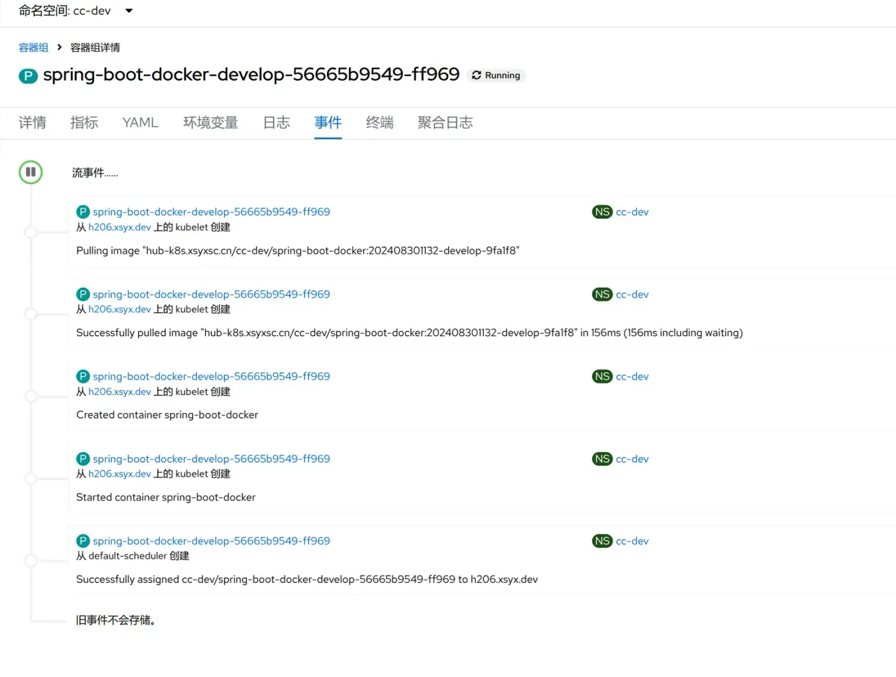
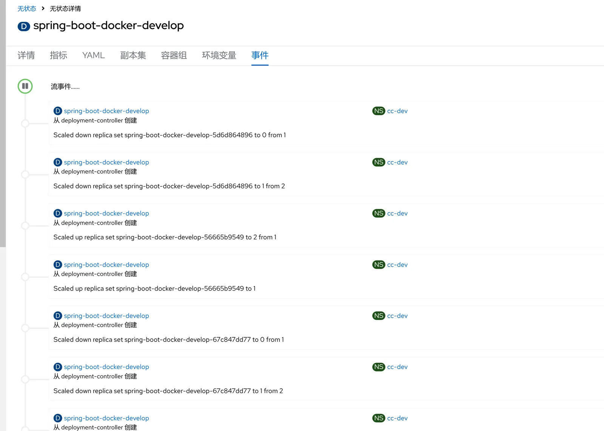
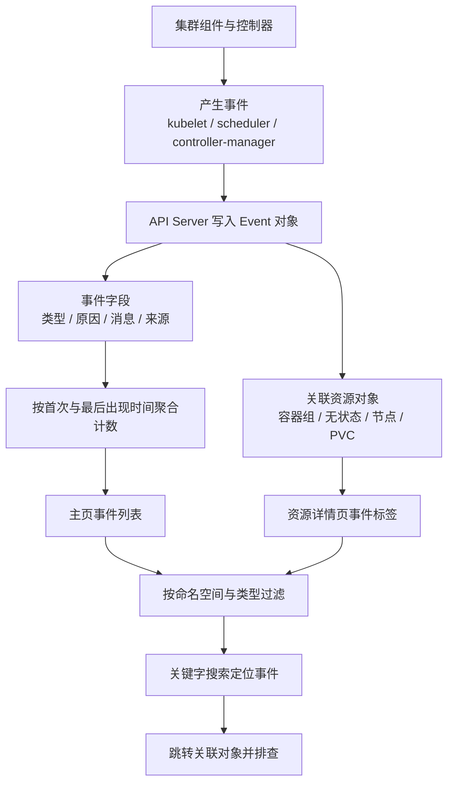
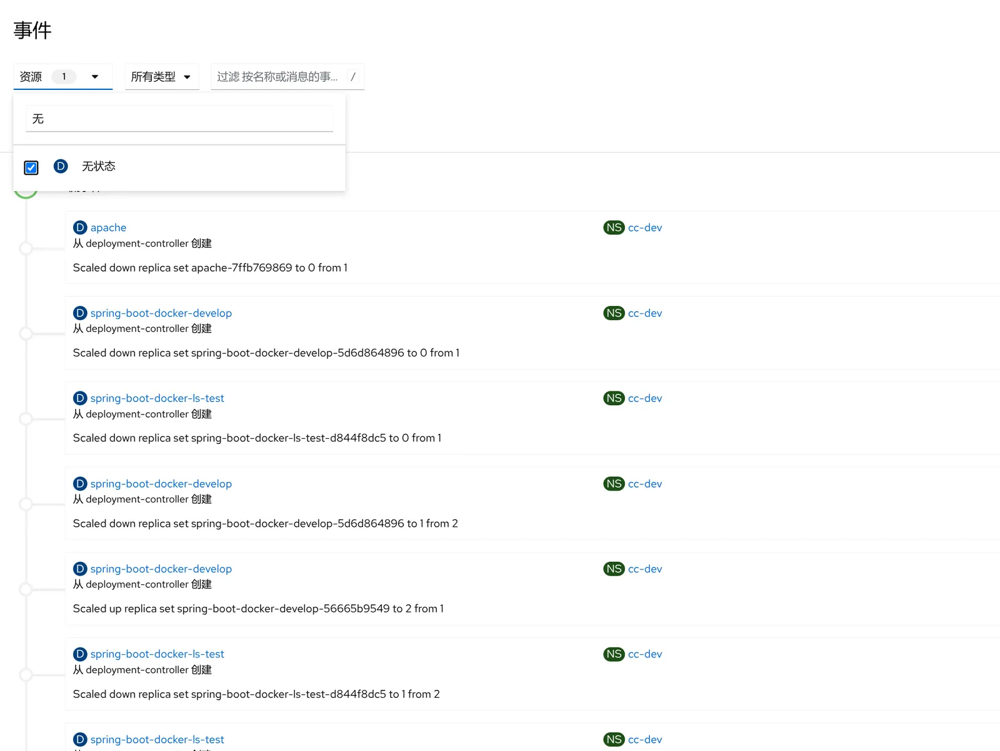

## 介绍

:::note

在 Kubernetes 中，事件（Event）是一种资源类型，用于记录集群内发生的各种活动和状态变化。
事件为集群操作提供了重要的上下文信息，帮助管理员诊断问题、了解系统行为以及跟踪关键操作。
每个事件都包含有关其来源（例如哪个组件触发了该事件）、涉及的对象（如容器组、服务等）以及发生的时间戳等详细信息。

:::

*图：事件列表页的筛选区、事件表格与 Warning/Normal 类型状态。*

事件回答的是“**什么时候、由谁、因为什么**发生了变化”，而不是资源当前处于什么状态。排查问题时，事件通常与指标、日志一起使用：

| 数据 | 回答的问题 | 典型用途 |
|---|---|---|
| 事件 | 发生了什么、发生在哪个对象上 | 调度失败、镜像拉取失败、挂载失败、健康检查失败 |
| 指标 | 资源使用是否异常、趋势如何 | CPU/内存水位、重启次数、延迟 |
| 日志 | 应用内部报了什么错 | 异常堆栈、业务错误、启动失败原因 |

## 访问事件

### 管理员入口

管理员可以在左侧菜单进入 **主页 → 事件**，查看集群范围的事件流。

### 开发者入口

开发者可以在项目的 **观察 → 事件** 中查看当前环境的事件。

### 资源详情页

容器组、无状态应用、有状态应用、节点、持久卷声明等资源详情页都集成了事件标签，用于查看与该对象关联的事件。

## 事件字段

| 字段 | 说明 | 排查价值 |
|---|---|---|
| 类型 | `Normal` 或 `Warning` | 优先关注 Warning |
| 原因 | 事件原因，如 `FailedScheduling`、`BackOff` | 直接指向问题类别 |
| 消息 | 人类可读的描述 | 通常包含镜像名、节点名、错误码 |
| 来源 | 产生事件的组件，如 kubelet、scheduler、controller-manager | 判断问题发生在哪一层 |
| 涉及对象 | Pod、Deployment、Node、PVC 等 | 跳转到对象详情继续排查 |
| 首次出现 | 事件第一次发生的时间 | 判断问题持续时间 |
| 最后出现 | 事件最近一次发生的时间 | 判断问题是否仍在发生 |
| 计数 | 相同事件聚合后的次数 | 区分偶发与持续失败 |

## 事件生命周期

事件本身不描述资源当前状态，而是记录状态变化。`计数` 与 `最后出现时间` 用于判断问题是持续发生还是已经收敛。

## 查看与筛选

事件列表通常支持以下操作：

- 按命名空间过滤，缩小到具体项目环境。
- 按类型过滤，只看 `Warning`。
- 按资源类型或资源名称过滤。
- 按原因或消息关键字搜索，例如 `FailedScheduling`、`ImagePullBackOff`、`OOMKilling`。
- 从事件跳转到关联的 Pod、Deployment、Node 或 PVC。

## 常见事件与含义

| 原因 | 类型 | 常见含义 | 下一步 |
|---|---|---|---|
| `FailedScheduling` | Warning | 没有满足资源、亲和性、污点或端口要求的节点 | 查看调度器消息，检查资源请求、节点污点与亲和性 |
| `ErrImagePull` | Warning | 镜像拉取失败 | 检查镜像地址、镜像仓库凭据、网络与证书 |
| `ImagePullBackOff` | Warning | 拉取失败后进入退避重试 | 先解决 `ErrImagePull` 的根因 |
| `CrashLoopBackOff` | Warning | 容器启动后反复退出 | 查看容器日志、退出码、启动命令与探针 |
| `OOMKilling` | Warning | 容器超过内存限制被杀死 | 调整内存 limit 或排查内存泄漏 |
| `Unhealthy` | Warning | 存活/就绪探针失败 | 检查探针路径、端口、启动时间和应用健康状态 |
| `FailedMount` | Warning | 存储卷挂载失败 | 检查 PVC、Secret、ConfigMap、CSI 与节点 |
| `FailedCreate` | Warning | 控制器创建 Pod 失败 | 检查配额、LimitRange、准入策略与事件消息 |
| `Evicted` | Warning | Pod 因节点资源压力被驱逐 | 检查节点资源、Pod 请求与优先级 |
| `Completed` | Normal | Job 或一次性任务正常结束 | 确认业务结果是否符合预期 |

## 排查流程

1. **先看 Warning**：在事件列表中筛选 `Warning`，按最后出现时间排序。
2. **确认对象**：从事件跳到关联的 Pod、Deployment、Node 或 PVC，查看其状态与配置。
3. **看计数与时间**：偶发一次通常是瞬时问题；计数持续增长说明问题仍在发生。
4. **对照指标**：CPU、内存、重启次数、延迟异常时，回到监控页面确认趋势。
5. **查看日志**：事件只说明“发生了什么”，应用内部原因通常要到容器日志或聚合日志中确认。
6. **验证修复**：修复后观察事件是否停止增长，并确认资源状态恢复。

## 限制与注意事项

- 事件由集群事件保留策略控制，保留时间通常较短，不适合作为长期审计记录。
- 事件可能被聚合，`计数` 很高但只显示一条记录；排查时要结合首次/最后出现时间。
- `Normal` 事件也可能包含重要信息，例如 Job 完成、镜像拉取成功、调度成功。
- 事件消息由不同组件生成，格式不完全统一；关键字搜索比精确匹配更实用。
- 删除事件不会删除关联资源，反之亦然。

## 最佳实践

- 将 Warning 事件纳入日常巡检，而不是等故障发生后再查。
- 对 `CrashLoopBackOff`、`OOMKilling`、`FailedScheduling` 建立固定排查路径。
- 事件、指标、日志使用同一个时间窗口对照，避免误判。
- 关键告警应配置到告警平台，不要依赖人工查看事件列表。
- 长期审计使用日志系统或审计日志，不依赖 Kubernetes Event。

## 相关文档

- [监控与告警](/docs/observability/monitoring/)
- [日志](/docs/observability/logging/)
- [告警配置](/docs/observability/alerting/)
- [容器组（Pod）](/docs/developer/workloads/pods/)
- [容器组排障](/docs/developer/workloads/pods/#故障排查)
